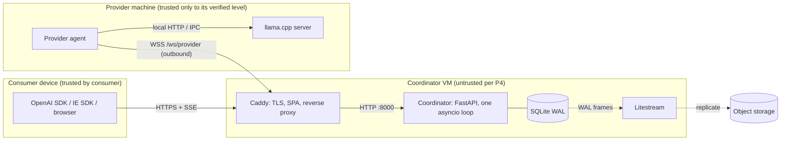
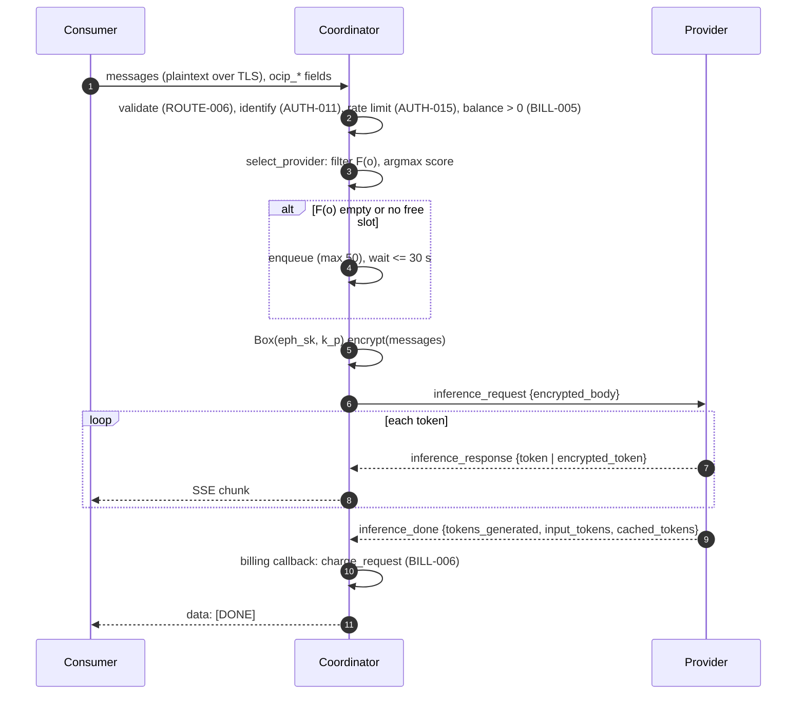
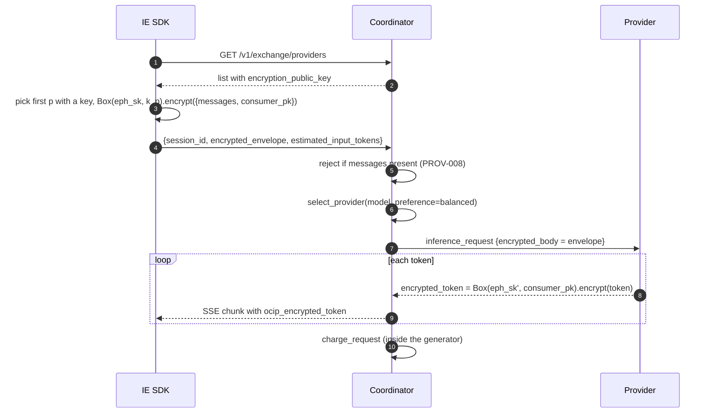
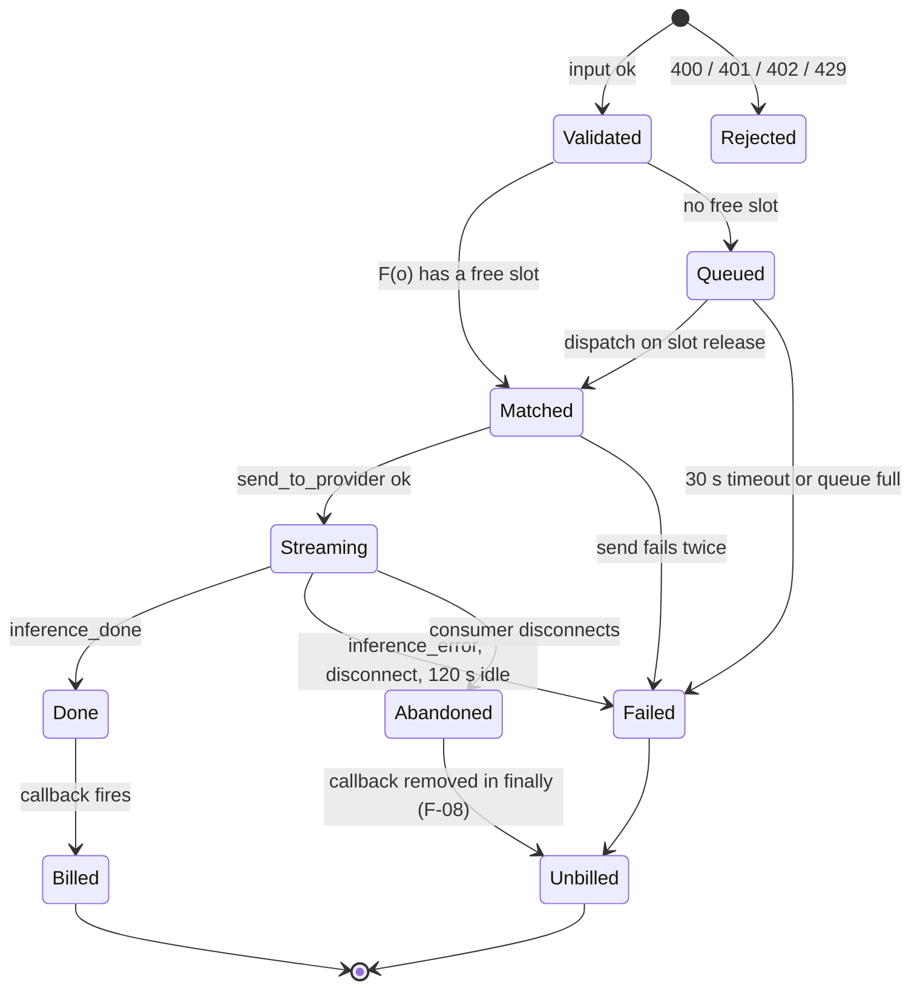
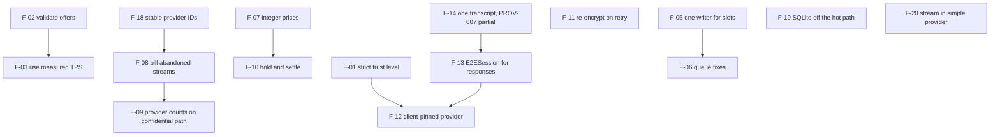

# Design review: a first-principles model of Inference Exchange

Status: Review. This document is not normative. The [principles](principles.md) and [requirements](requirements/README.md) are the source of truth. Each proposal here needs approval from the project owner before it becomes a requirement or a code change.

Last update: October 2026. The review covers the local working tree at that date.

## 0. Scope and method

This review derives the system from its axioms. It then checks the code against each derived property.

The review uses three kinds of statement. Each statement shows its kind:

- **Axiom (A)**: A principle, written as a formula.
- **Property (T)**: A statement that follows from the axioms. The review gives the proof or the counter-example from the code.
- **Finding (F)**: A place where the code does not obey a property. Each finding has evidence and a proposed change with a defense.

What the review checked:

- It read the coordinator (`coordinator/*.py`, `matching/*`), the shared protocol and crypto (`shared/*`), the simple provider (`provider/agent.py`), the OCIP agent (`ocip_agent/agent.py`, key paths only), the confidential SDK (key paths only), and `deploy/`.
- It ran small scripts against the real modules to confirm F-01, F-02, F-03, F-06, F-07, F-08, and F-14. Section 14 lists the checks and the output.

What the review did not check:

- It did not run a load test. All throughput and latency numbers in sections 10 and 11 are first-principles bounds or estimates. The text marks them as estimates.
- It did not test a real HTTP client disconnect through Starlette. F-08 was reproduced at the hub level. The claim that Starlette runs the generator `finally` block on disconnect comes from code reading.
- F-05, F-11, F-12, F-13, F-17, F-18, and F-20 come from code reading only.
- It did not review `web/`, `provider-hardened/`, or `infra/` in depth.

## 1. Axioms

Let $\mathcal{C}$ be the set of consumers, $\mathcal{P}$ the set of connected providers, and $\mathcal{R}$ the set of requests. Let $L = \{0,1,2,3\}$ be the ordered trust levels (open, contained, hardened, confidential).

| ID | Principle | Formal statement |
|---|---|---|
| A1 | P1, no silent downgrade | $\forall r \in \mathcal{R}: \mathrm{route}(r) = p \Rightarrow \ell_{\mathrm{ver}}(p) \ge \ell_{\min}(r)$. If no such $p$ exists, then $\mathrm{route}(r) = \bot$. |
| A2 | P2, transparent system | Every public output $f$ satisfies $k$-anonymity: each published bucket aggregates $\ge k$ requests. No public field is a function of one consumer only. |
| A3 | P3, claim is not evidence | Each provider has two values: $\ell_{\mathrm{claim}}(p)$ and $\ell_{\mathrm{ver}}(p) \in L \cup \{\bot\}$. Only evidence $e$ with $\mathrm{Verify}(e) = 1$ can set $\ell_{\mathrm{ver}}$. |
| A4 | P4, untrusted coordinator | Security properties must hold for an adversary $\mathcal{A}$ that controls the coordinator. Where possible, the client verifies. |
| A5 | P5, user keeps keys | The coordinator state never contains an external provider key of a user. |
| A6 | P6, deny by default | An endpoint $e$ is public only if a requirement $q$ with $\mathrm{public}(e) \in q$ exists. |
| A7 | P7, money is correct | For each charge $b$: $\mathrm{debit}(b) = \mathrm{credit}(b) + \mathrm{fee}(b)$, all values in $\mathbb{Z}_{\ge 0}$ micro-USD. |
| A8 | P8, simple components | Prefer the design with fewer components. Scale up before scale out. |
| A9 | P9, tested | $\mathrm{status}(q) = \text{implemented} \Rightarrow \exists$ a passing test $t \in \mathrm{VerifiedBy}(q)$. |

A physical axiom completes the set:

| ID | Source | Formal statement |
|---|---|---|
| A0 | Physics | A signal in optical fibre travels at $v = c/n \approx 2.04 \times 10^{8}$ m/s ($n \approx 1.47$). One kilometre of fibre costs at least $4.9\ \mu\text{s}$ one way. No protocol can be faster than the distance divided by $v$. |

A0 sets the lower bound for every latency in section 10. The review compares the design with this bound, not with other software.

## 2. System model

### 2.1 State

The coordinator is one process (decision [0004](decisions/0004-single-vm-sqlite.md)). Its state is the tuple:

$$
S = (\underbrace{P, Q, A, \mathit{Aff}, \mathit{Rep}, \mathit{TPS}, \mathit{Tr}}_{\text{memory, volatile}},\ \underbrace{U, K, B, T}_{\text{SQLite, durable}})
$$

| Symbol | Meaning | Code |
|---|---|---|
| $P$ | Connected providers, `provider_id -> ConnectedProvider` | `ProviderHub._providers` |
| $Q$ | Pending request queue, capacity 50 | `ProviderHub._pending_queue` |
| $A$ | Active request map, `request_id -> provider_id` | `ProviderHub._request_to_provider` |
| $\mathit{Aff}$ | Session affinity, `session_id -> provider_id`, max 1000 | `ProviderHub._session_affinity` |
| $\mathit{Rep}$ | Reputation EMA per provider | `ReputationTracker` |
| $\mathit{TPS}$ | Observed tokens per second per provider and model | `TPSTracker` |
| $\mathit{Tr}$ | Last 100 routing traces | `dependencies._request_traces` |
| $U, K$ | Users, API keys (SHA-256 hashes) | `users`, `api_keys` tables |
| $B$ | Account balances, micro-USD | `accounts` table |
| $T$ | Transaction ledger | `transactions` table |

### 2.2 Provider offer

A provider $p$ publishes an offer vector at registration:

$$
\omega(p) = (M_p,\ \pi^{\text{in}}_p,\ \pi^{\text{out}}_p,\ \pi^{\text{cache}}_p,\ \ell_{\mathrm{claim}}(p),\ \tau_p,\ c_p,\ k_p)
$$

- $M_p$: model set.
- $\pi$: prices in USD per million tokens.
- $\tau_p$: claimed throughput (tokens per second).
- $c_p$: slot count (`max_concurrent`).
- $k_p$: X25519 public key.

All fields of $\omega(p)$ are claims (A3). The coordinator verifies none of them today, except an optional model file hash (`verify_model_hash`).

### 2.3 Order

A request $r$ is an order:

$$
o(r) = (m_r,\ \bar\pi_r,\ \ell_{\min}(r),\ \mathit{pref}_r,\ s_r)
$$

with model $m_r$, price ceiling $\bar\pi_r$ (output price only, ROUTE-002), minimum level, preference, and session ID.

## 3. Architecture

### 3.1 Components and trust boundaries

The provider opens the WebSocket. This is a deliberate choice: providers are behind NAT, so the coordinator cannot dial them. The cost of this choice is the star topology in section 10.

### 3.2 Standard request (`POST /v1/chat/completions`)

Step 6 is the known plaintext exposure. The coordinator holds the plaintext between steps 1 and 6 ([status](status.md), #68).

### 3.3 Confidential request (`POST /v1/confidential/infer`)

Steps 2, 3, and 6 are the subject of F-01, F-12, and F-13.

### 3.4 Request lifecycle as a state machine

The safety property of the lifecycle is: every path ends in exactly one of `Billed` or `Unbilled`, and `Billed` happens at most once. Section 6 proves the second half and shows where the first half is wrong for the business rule BILL-007.

## 4. Matching

### 4.1 Definition

The matching function has two stages: a feasibility filter, then an argmax. For an order $o$ and the provider set $P$:

$$
F(o) = \{\, p \in P \;:\; \mathrm{adm}(p) \,\wedge\, (m_o = \texttt{default} \vee m_o \in M_p) \,\wedge\, \pi^{\text{out}}_p \le \bar\pi_o \,\wedge\, \ell(p) \ge \ell_{\min}(o) \,\wedge\, u_p < c_p \,\}
$$

$$
\mathrm{route}(o) = \begin{cases} \arg\max_{p \in F(o)} s(o,p) & F(o) \ne \emptyset \\ \bot\ (\text{queue, then fail}) & F(o) = \emptyset \end{cases}
$$

Here $u_p$ is `active_requests` and $\mathrm{adm}(p)$ is `ConnectedProvider.admitted`. The score is:

$$
s(o,p) = \underbrace{\left( w^{o}_{\pi}\,\frac{1}{1+\pi^{\text{out}}_p} + w^{o}_{\tau}\,\frac{\tau_p}{10+\tau_p} + w^{o}_{\ell}\,\frac{\ell(p)}{4} + w^{o}_{u}\left(1-\frac{u_p}{c_p}\right)\right)}_{\text{linear utility } \mathbf{w}^{o}\cdot\boldsymbol\phi(p)} \cdot \underbrace{\left(\tfrac12 + \tfrac12\rho_p\right)}_{\text{reputation}} \cdot \underbrace{1.2^{[\mathit{Aff}(s_o)=p]}}_{\text{affinity}}
$$

The weight vectors $\mathbf{w}^{o} = (w_\pi, w_\tau, w_\ell, w_u)$ sum to 1:

| Preference | $w_\pi$ | $w_\tau$ | $w_\ell$ | $w_u$ |
|---|---|---|---|---|
| cheapest | 0.60 | 0.15 | 0.10 | 0.15 |
| fastest | 0.10 | 0.60 | 0.10 | 0.20 |
| most_secure | 0.10 | 0.10 | 0.60 | 0.20 |
| balanced | 0.35 | 0.25 | 0.20 | 0.20 |

Code: `matching/strategy.py::compute_score`, `GreedyStrategy.match`, `provider_hub.py::select_provider`.

### 4.2 Properties

**T1 (constraints are hard).** If $\mathrm{route}(o) = p$, then $p \in F(o)$.

Proof. `compute_score` returns $-1$ for every $p \notin F(o)$. For $p \in F(o)$, every factor of $s$ is positive when $\pi \ge 0$, $\tau \ge 0$, $c_p > 0$, $\rho \in [0,1]$. So $s > 0$. `GreedyStrategy` accepts a match only when `best_score > 0`. So the winner is in $F(o)$. ∎

This proof needs the side condition $\pi^{\text{out}}_p \ge 0$. F-02 shows that the code does not enforce it.

**T2 (affinity cannot break constraints, ROUTE-003).** The affinity factor multiplies $s$ only. It does not change $F(o)$. By T1, an affinity provider outside $F(o)$ is never selected. ∎

**T3 (the retry obeys trust and price, part of ROUTE-008).** The retry in `routes_inference.py` calls `select_provider` with the same `min_confidence` and `max_price`. By T1, the retry provider is in $F(o)$. ∎ F-11 shows a separate defect in the retry.

**T4 (greedy is optimal for one order).** `select_provider` always calls `match` with one order. For one order, the optimum over feasible assignments is $\arg\max_{p \in F(o)} s(o,p)$. A linear scan finds it in $\Theta(|P|)$. No algorithm can do better without an index, because each $p$ can be the maximum. ∎

**T5 (monotonicity).** Each term of $\boldsymbol\phi$ is monotone in the right direction: $\partial\phi_\pi/\partial\pi < 0$, $\partial\phi_\tau/\partial\tau > 0$, $\partial\phi_\ell/\partial\ell > 0$, $\partial\phi_u/\partial u < 0$. So, all else equal, a cheaper, faster, more trusted, or less loaded provider never scores lower. ROUTE-004 follows when the weights differ. ∎

Notes on the score shape:

- $\phi_\tau = \tau/(10+\tau)$ saturates. At $\tau = 30$ it is 0.75. At $\tau = 1000$ it is 0.99. This limits the gain from a false $\tau$ claim to at most $w_\tau$, but it does not remove the gain (F-03).
- $\phi_\ell = \ell/4$ has a maximum of 0.75, because no level 4 exists in `ConfidenceLevel`. This is harmless. It is a constant scale on one term.
- The score is not a price. It is an ordinal utility. Only the order of the scores matters. A consequence: cross-preference comparisons of scores have no meaning, and traces must not present them as such.
- `BatchAuctionStrategy` is not on the live path. Its docstring says "Hungarian", but the code is a most-constrained-first greedy. That greedy is not optimal in general. Counter-example: orders $o_1, o_2$, slots $a, b$, scores $s(o_1,a)=0.9$, $s(o_1,b)=0.8$, $s(o_2,a)=0.8$, $s(o_2,b)=0.1$, both orders with two eligible slots. Greedy gives $0.9+0.1=1.0$. The optimum is $0.8+0.8=1.6$. Under A8, the review proposes to mark it as experimental or remove it, until a batch path exists.

### 4.3 Findings

**F-01. An unknown trust level becomes level 0 (P1, High).**

Evidence: `select_provider` maps the request field with `conf_map.get(min_confidence, ConfidenceLevel.OPEN)`. Any value that is not an exact lower-case key maps to `OPEN`. The review confirmed that `"Hardened"` maps to 0. A consumer who asks for `"Hardened"`, `"L2"`, or `"hardened "` gets $\ell_{\min} = 0$. This is a silent downgrade, which A1 forbids. In addition, `routes_confidential.py` passes no `min_confidence`, so the confidential path uses the default `"open"`.

Change: Parse `ocip_min_confidence` with the `TrustLevel` enum in the Pydantic request model. Reject an unknown value with HTTP 400. On the confidential path, set $\ell_{\min} = 3$ (confidential).

Defense: A1 says "stop and tell the consumer". A parse error is the earliest point to stop. A lenient parse (case-folding) would also fix the example, but it keeps a class of silent mappings. Strict parsing is the smaller rule and is easy to test. The same rule makes ROUTE-001 hold for all inputs, not only for the valid ones.

Requirement impact: ROUTE-006 can add "unknown `ocip_min_confidence`" to its list of HTTP 400 cases. ROUTE-001 needs a test with an invalid level.

**F-02. Provider offers are not validated (P6, P7, High).**

Evidence: `ProviderCapabilities` accepts any float. The review registered `price_per_mtok_output = -1.0`, `measured_tps = 1e9`, and `max_concurrent = 10**6` without error. Then:

- With $\pi = -0.99$, $\phi_\pi = 100$, and the score is 35.4 against 0.78 for an honest provider. The provider wins every request.
- With $\pi = -1$, $\phi_\pi = 1/0$. `GreedyStrategy.match` raises `ZeroDivisionError`. `select_provider` scores every provider for every request, so one such provider makes every request fail with HTTP 500. One connection can stop the exchange.
- A negative price gives a negative cost, then `max(cost, 100)` bills the minimum. The money stays correct, but the price ceiling and the score are wrong.

Change: Add bounds to `ProviderCapabilities`: $\pi \in [0, \pi_{\max}]$, $\tau \in [0, \tau_{\max}]$, $c \in [1, c_{\max}]$, non-empty `models`. Reject the registration with close code 4001 if a bound fails.

Defense: The filter-then-score design in 4.1 is correct only on the domain $\pi \ge 0$ (T1). Validation at the boundary restores the domain once, so the scoring code stays simple. A `try/except` in the scorer is the alternative. It hides the bad input and keeps the bad provider connected, so it is worse. A6 also prefers rejection at the edge.

**F-03. Throughput is a claim, and the measured value is not used (P3, Medium).**

Evidence: The score uses `capabilities.measured_tps`, which the provider sends. `TPSTracker.get_effective_tps` exists, but nothing calls it. The review confirmed that under `fastest`, a claim of $10^6$ tok/s scores 0.94 against 0.79 for an honest 30 tok/s provider.

Physics gives an upper bound for the claim. Autoregressive decode reads all weights once for each token, so it is memory-bandwidth bound:

$$
\tau \le \frac{\mathrm{BW}_{\text{mem}}}{|W|}
$$

For an M2 Pro ($\mathrm{BW} \approx 200$ GB/s) and a 7B model at 4-bit ($|W| \approx 4.1$ GB), $\tau \le 49$ tok/s. The table in `tps_tracker.py` gives 45. A claim far above this bound is false.

Change: Use $\tau_{\text{eff}} = $ `get_effective_tps(...)` in the score. Until three measurements exist, use $\min(\tau_{\text{claim}}, \tau_{\text{table}})$.

Defense: The observed EMA is evidence (A3). The table is a prior. The claim is the weakest input, so it must not be the only input. The code already contains the estimator, so the change adds no new component (A8).

**F-04. The trace scores are not the decision scores (P3, Low).**

Evidence: `score_for_request` builds an order with the default `min_confidence = HARDENED`, no price ceiling, no reputation, and no affinity. The real decision uses the request values. The trace can show $-1$ for a provider that was eligible, and a different winner order.

Change: Return the scores from the `select_provider` call and put those in the trace.

Defense: A trace that shows a different calculation is a claim presented as a fact. One computation is also cheaper than two.

## 5. Concurrency and capacity

### 5.1 Model

The coordinator runs one asyncio event loop. All handlers are cooperative. Between two `await` points, a handler has exclusive access to $S$. So every synchronous block is atomic with respect to $S$. This is the main correctness tool of the coordinator. It replaces locks.

The provider capacity invariant is:

$$
\textbf{I}_{\text{cap}}:\quad \forall p \in P:\ 0 \le u_p \le c_p
$$

### 5.2 Properties

**T6 (select-then-send is atomic).** In `chat_completions`, the path from `select_provider` to `send_to_provider` has no `await` until `ws.send_json`. `send_to_provider` increments $u_p$ before its first `await`. So no other handler can observe $p$ as free between the check $u_p < c_p$ and the increment. ∎

Two consequences follow:

- The standard path does not over-commit $p$ through itself.
- The design would break if a future change adds an `await` between selection and send, for example an async balance lookup. The review proposes a comment at that point in the code.

**F-05. Heartbeats overwrite the slot count (Medium).**

Evidence: `handle_heartbeat` sets $u_p \leftarrow$ `msg.active_requests`. The provider sends the heartbeat every 10 s. The provider counts a request only when its handler task starts, so the count lags the coordinator by one network delay or more. If the coordinator sends a request at $t$, and a heartbeat from $t - \delta$ arrives at $t + \epsilon$, then $u_p$ drops by one. A second request can then take the slot, and $u_p > c_p$ at the provider. Also, $u_p$ is decremented on `inference_done`. If the heartbeat already counted the finish, the coordinator decrements a second time. `max(0, ...)` hides the negative value but not the drift.

Change: Make the coordinator the only writer of $u_p$. Use the heartbeat value only to detect drift (log and metric).

Defense: A counter with two writers and no order between them is a race by definition. The coordinator sees every send and every `inference_done` or `inference_error`, so it has all the information for an exact count. One writer makes $\mathbf{I}_{\text{cap}}$ provable by T6.

**F-06. The queue loses fairness and keeps dead entries (ROUTE-005, Medium).**

Evidence:

1. A request that timed out stays in `_pending_queue`. The review confirmed that the queue size is still 1 after the waiter timed out. A dead entry holds one of 50 places. Fifty timed-out requests fill the queue, and every later request gets `QueueFull` for as long as no slot is released.
2. When a slot is released, `_try_dispatch_queued` can match a dead entry. It sets the event, but no waiter exists, so the slot is not used and the next live request waits.
3. Dispatch sets `pending.provider` but does not increment $u_p$. The waiter increments it later in `send_to_provider`. Between the two, a new direct request can take the slot. The queued request then sends to a full provider.
4. Only one entry is dispatched for each released slot. If the queue holds requests for different models, a free slot for model A cannot help the head entry for model B, and the scan stops after the first match.
5. Queued requests are encrypted only after dispatch, to the key of the assigned provider. This is correct. But the queue path has no retry, and the retry of the direct path is defective (F-11).

Change: On timeout, mark the entry as cancelled; skip cancelled entries in dispatch. In dispatch, reserve the slot ($u_p \mathrel{+}= 1$) in the same synchronous block as the match, and send in the waiter without a second increment. Loop dispatch while a free slot and a matching entry exist.

Defense: The queue is a FIFO with a feasibility predicate. The correct semantics is "the oldest feasible live entry gets the slot". Each of the three changes removes one way in which a live request waits behind a slot that nobody uses. The cost is $O(|Q|)$ for each release, with $|Q| \le 50$. That is cheap.

### 5.3 Little's law and the queue bound

For a stable system, Little's law gives $N = \lambda W$. With $\lambda$ the arrival rate of requests that do not find a slot, the queue of depth 50 and timeout 30 s holds all such requests if:

$$
\lambda_{\text{overflow}} \cdot \bar W \le 50, \quad \bar W \le 30\ \text{s}
$$

So the queue absorbs an overflow rate of at least $50/30 \approx 1.7$ requests per second in the worst case. A request that waits for a slot waits on average about one service time. For a chat answer of 300 tokens at 30 tok/s, that is 10 s. The 30 s timeout is three service times. This is a reasonable choice for an alpha. It is not a choice that comes from a requirement. The review proposes to state these two numbers as a requirement, so a change needs approval.

## 6. Billing

### 6.1 Definition

For a charge with fresh input tokens $n_i$, cached tokens $n_c$, and output tokens $n_o$:

$$
\mathrm{cost} = \max\!\left(\left\lfloor \tfrac{n_i}{10^6}\pi^{\text{in}} 10^6 \right\rfloor + \left\lfloor \tfrac{n_c}{10^6}\pi^{\text{cache}} 10^6 \right\rfloor + \left\lfloor \tfrac{n_o}{10^6}\pi^{\text{out}} 10^6 \right\rfloor,\ 100\right)
$$

$$
\mathrm{fee} = \left\lfloor \tfrac{10 \cdot \mathrm{cost}}{100} \right\rfloor, \qquad \mathrm{credit} = \mathrm{cost} - \mathrm{fee}
$$

Code: `store.py::Store.charge_request`.

### 6.2 Properties

**T7 (books balance, BILL-001).** $\mathrm{debit} = \mathrm{cost} = \mathrm{credit} + \mathrm{fee}$. Proof: $\mathrm{credit}$ is defined as $\mathrm{cost} - \mathrm{fee}$ in $\mathbb{Z}$. ∎ This is the right construction. Compute one share with rounding, and the other share as the remainder. Then rounding cannot create or lose a micro-dollar.

**T8 (no negative amounts, BILL-003).** $\mathrm{cost} \ge 100 > 0$. $\mathrm{fee} = \lfloor \mathrm{cost}/10 \rfloor \in [0, \mathrm{cost}]$. So $\mathrm{credit} \in [0, \mathrm{cost}]$. ∎

**T9 (conservation across the ledger).** Let $\Sigma B$ be the sum of all balances. Each charge changes $\Sigma B$ by $-\mathrm{cost} + \mathrm{credit} = -\mathrm{fee}$. The platform fee has no account. So:

$$
\Sigma B(t) = \Sigma B(0) + \text{grants} - \sum_{b \le t} \mathrm{fee}(b)
$$

The ledger balances only if the platform is an account. The review proposes a `platform` account that receives $\mathrm{fee}$. Then $\Sigma B$ is constant under charges, and a test can check one equation for the whole database.

**T10 (atomic charge).** `charge_request` runs three statements and one `commit`. In Python `sqlite3`, the first `UPDATE` opens an implicit transaction, and the `commit` ends it. So all three writes are durable together or not at all. ∎ One exception: `_ensure_account` calls `commit` inside the charge if the provider account does not exist. That splits the transaction into two. The debit can then be durable without the credit if the process stops between the two commits. In practice, registration creates the account first, so the path is rare. The change is to use `INSERT OR IGNORE` without a commit inside `charge_request`.

### 6.3 Findings

**F-07. Floating-point price arithmetic (P7, Medium).**

Evidence: Prices are `float` USD. `int(x)` truncates. The review confirmed that $10^5$ tokens at \$0.57 per Mtok give 56999 micro-USD, not 57000, because $0.1 \times 0.57 \times 10^6 = 56999.99\ldots$ in IEEE 754. P7 says "use integer arithmetic for money". The ledger is integer, but the price is not.

Change: Store prices as integer micro-USD per Mtok, $\hat\pi \in \mathbb{Z}_{\ge 0}$. Then $\mathrm{cost} = \lfloor n \hat\pi / 10^6 \rfloor$ in exact integer arithmetic.

Defense: The error is at most one micro-USD for each tier, so it is small. But a rule with a known exception is not a rule. Integer prices also make the price ceiling comparison exact.

**F-08. A consumer who disconnects is never billed (BILL-006, BILL-007, High).**

Evidence: `_stream_response` calls `hub.remove_response_queue(request_id)` in `finally`. `remove_response_queue` also removes the billing callback. If the consumer closes the connection, the generator stops and `finally` runs before `inference_done` arrives. The callback is gone, so the charge never happens. The provider did the work and gets nothing. The review reproduced this with the hub directly: of two requests, only the one whose queue was still present at `inference_done` was billed.

The comment in `handle_provider_message` says the opposite ("billing must fire even after the response queue is cleaned up"). The code was meant to handle this case, but `remove_response_queue` defeats it. [Status](status.md) also says a cancelled stream "is billed in full", which is not what the code does.

Also, the coordinator does not send `cancel_request` to the provider, so the provider keeps generating tokens that nobody reads.

Change:

1. `remove_response_queue` removes the queue only. The billing callback stays until `inference_done`, `inference_error`, or provider disconnect.
2. On consumer disconnect, send `cancel_request`. The OCIP agent already handles it.
3. For BILL-007, bill $n_o$ = tokens delivered to the coordinator, which the coordinator can count.

Defense: The billing event must depend on the provider's work, not on the consumer's connection. That is what the callback design wants. The change removes one line that breaks it. Change 2 bounds the wasted work to one network round trip: about $2d/v$ of tokens, by A0.

**F-09. The confidential path bills on consumer-reported input (P7, Medium).**

Evidence: `routes_confidential.py` charges `input_tokens = request.estimated_input_tokens`, which the consumer sends. The default is 0. A consumer can pay for output only. It counts output as the number of chunks, not `inference_done.tokens_generated`. The charge also runs inside the generator, so F-08 applies here too, in the opposite way: if the consumer disconnects, the code after the loop never runs.

Change: Use the provider's `inference_done` counts, as on the standard path, through the same callback.

Defense: The provider decrypts the prompt, so the provider is the only party that can count input tokens. The consumer has an incentive to under-report. The provider has an incentive to over-report, but its count is bounded by the ciphertext length: $n_i \le |\text{ciphertext}|$ bytes (one token is at least one byte). The coordinator can check this bound without plaintext.

**F-10. The balance check is a race (BILL-005, Low, known as #59).**

Evidence: The check is $B_c > 0$ at admission. The charge happens later. With $k$ parallel requests, the balance can go to $-k \cdot \mathrm{cost}_{\max}$, not $-\mathrm{cost}_{\max}$. The rate limit bounds $k$ by the burst of 10.

Change: Reserve a hold $h = \mathrm{cost}(n_i, \text{max\_tokens})$ at admission. Settle to the real cost at the end. This is the standard authorize-and-capture pattern.

Defense: The hold makes the admission rule exact: $B_c - \sum h \ge 0$. With integer prices (F-07), the hold is exact.

## 7. Cryptography

### 7.1 Adversary model

By A4, the adversary $\mathcal{A}$ controls the coordinator. $\mathcal{A}$ can read, drop, delay, reorder, replay, and inject any message between consumer and provider. $\mathcal{A}$ can serve any provider list and any public key. $\mathcal{A}$ cannot break X25519, XSalsa20-Poly1305, AES-GCM, Ed25519, or SHA-256.

The goals are:

| Goal | Formal statement |
|---|---|
| Conf | $\mathcal{A}$ learns nothing about the prompt $x$ or the answer $y$, except their lengths and timing. |
| Int | The consumer accepts $y'$ only if $y' = y$, the exact ordered output of the provider for this request. |
| Auth | The consumer accepts a key $k_p$ only if $k_p$ belongs to an admitted provider at $\ell \ge \ell_{\min}$. |
| FS | Compromise of a long-term key at time $t$ does not reveal traffic before $t$. |

### 7.2 Standard path

The coordinator encrypts $x$ itself, so $\mathcal{A}$ has $x$. Conf fails against $\mathcal{A}$. This is known (#68) and the docs state it. The NaCl Box protects only the coordinator-to-provider link against a party that is not the coordinator. TLS through Caddy already protects that link. So, against the stated adversary, the Box on the standard path adds no property. It adds value only when the WebSocket does not use TLS (`make dev`).

### 7.3 Confidential path, as built

The live path uses `shared/crypto.py`: one NaCl Box for the request, and one NaCl Box for each response token.

$$
\mathrm{env} = (\mathit{epk},\ n,\ \mathrm{XSalsa20Poly1305}_{K}(n, x)),\quad K = \mathrm{HSalsa20}(\mathrm{X25519}(\mathit{esk}, k_p))
$$

**T11 (request Conf against a passive coordinator).** If $k_p$ is the true provider key, $\mathcal{A}$ sees only $\mathit{epk}$, $n$, and the ciphertext. Box is IND-CCA2 secure under the Gap-DH assumption on Curve25519. So Conf holds for the request. ∎

**T12 (no forward secrecy for the provider key).** The docstring of `crypto.py` says "forward secrecy". The provider key $k_p$ lives for the whole agent process. Since $\mathrm{X25519}(\mathit{esk}, k_p) = \mathrm{X25519}(\mathit{sk}_p, \mathit{epk})$ and $\mathit{epk}$ is in each envelope, the provider private key $\mathit{sk}_p$ decrypts every envelope that was sent to it. So FS fails for all traffic of one agent run. FS holds only across agent restarts, because the agent makes a new key at start. ∎ The docstring needs a correction. The `e2e.py` design (both sides ephemeral) has FS.

**F-12. The consumer and the coordinator select the provider separately (P1, P4, High).**

Evidence: `ConfidentialClient._discover_provider` takes the first provider with a key from `/v1/exchange/providers`. It encrypts to that key. The request does not name the provider. `confidential_infer` then calls `select_provider(..., preference="balanced")` and can choose any provider. With $|P| \ge 2$, the envelope often goes to a provider that cannot decrypt it, and the request fails. In addition, no $\ell_{\min}$ is passed (F-01), so the selected provider can be level 0.

Also, Auth fails: the coordinator serves the key. $\mathcal{A}$ can serve its own key and read $x$. The [protocol](security/protocol.md) (section 4) states this limit. The code must not hide it.

Change: The consumer selects the provider from a signed admission record (`/v1/exchange/confidential/providers`). The request carries `provider_id` and the key fingerprint $H(k_p)$. The coordinator routes to that provider only, after the check $p \in F(o)$ with $\ell_{\min} = 3$. If the check fails, it returns an error. It does not choose another provider.

Defense: Encryption fixes the destination at the client. So the routing decision must also be at the client, or the system is inconsistent. A1 also forbids a fallback that the client did not approve. This change moves the argmax of section 4 to the client for this path. The client can compute it, because the offer list is public (A2). P4 says: where possible, the client checks the destination.

**F-13. Response tokens are not bound to order or request (P4, High).**

Evidence: The agent encrypts each token with a new Box to `consumer_public_key`. The SDK keeps one key pair for its whole life. A token ciphertext carries no request ID and no sequence number. So $\mathcal{A}$ can drop tokens, reorder them, repeat them, or insert tokens from an earlier answer to the same SDK instance. Each forged stream decrypts correctly. Int fails.

Cost is also high. Each token costs one X25519 scalar multiplication (about 50 µs, an estimate for libsodium on a laptop core) and 72 bytes of overhead before base64 ($32 + 24 + 16$).

Change: Use the `E2ESession` of `shared/e2e.py` for responses. Its AAD binds version, session ID, direction, and sequence number. Its `decrypt` rejects a sequence number that does not increase. Add a final message that carries the total token count and is authenticated in the same session, so truncation is also detected.

Defense: `e2e.py` already exists and has tests (`tests/test_e2e.py`). It gives Int with order (AEAD plus a strictly increasing counter). It also costs one AES-GCM call for each token (about 1 µs with AES-NI or ARMv8 crypto), so the cost drops by about 50 times. No new component is necessary (A8).

**F-14. PROV-007 tests a module that no request uses (P9, Medium).**

Evidence: PROV-007 is `implemented`. Its tests check `shared/e2e.py`. A search of the code shows that only tests import `E2ESession` and `derive_session`. The live path uses `shared/crypto.py`, which has no replay or direction check. The `sequence_number` field of `ConfidentialInferenceRequest` is not read.

Also, `shared/e2e.py::_transcript` and `shared/handshake.py::HandshakeParameters.transcript` put the fields in a different order (`admission_id` is in position 7 in one and position 4 in the other). The review confirmed that the two functions give different bytes for the same input. A signature made with one fails with the other.

Change: Set PROV-007 to `partial` until the live path uses `e2e.py`. Keep one transcript function and import it in both modules.

Defense: A9 says a requirement is done when a test shows it. A test of a library that the system does not call shows a property of the library, not of the system. One canonical serialization is the [protocol](security/protocol.md) rule in section 6 ("deterministic and specified").

### 7.4 Properties that hold

These parts are correct. The review records them, so that a future change does not break them.

- **API keys.** The key has 128 bits of entropy (`token_hex(16)`). The store keeps $\mathrm{SHA256}(\text{key})$. A slow hash is not necessary: a brute-force search needs about $2^{127}$ hash calls on average. A slow hash protects low-entropy secrets only.
- **JWT.** `verify_jwt` ignores the header and always computes HMAC-SHA256. So the `alg: none` and algorithm-confusion attacks do not apply. It compares with `hmac.compare_digest`. Logout increments `session_version`, which is in the token (`sv`), so all old tokens fail (AUTH-004).
- **OAuth.** The flow uses `state` and PKCE (AUTH-001, AUTH-002).
- **Nonces.** Box uses random 24-byte nonces. For $q$ messages under one key, the collision probability is at most $q^2 / 2^{193}$. This is negligible. `e2e.py` uses an 8-byte counter and 4 random bytes, so nonces are unique by construction while the counter increases.

One weak point is outside the production path: password hashes use one SHA-256 round with a salt. AUTH-005 turns password sign-in off in production. If `IE_PASSWORD_AUTH=1` is set, the hash must be a memory-hard function (scrypt or Argon2id).

## 8. Privacy and input limits

**F-15. The provider message size limit is checked after the read (P6, Low).**

Evidence: The provider WebSocket loop reads the full frame with `ws.receive_text()`, then compares `len(raw)` with `WS_MAX_MESSAGE_SIZE` (1 MB). The memory is already used when the check runs. The real limit is the Uvicorn WebSocket default (16 MiB for each message, for the `websockets` implementation). Also, the check counts characters, not bytes.

Change: Set `ws_max_size=1_000_000` in the Uvicorn configuration. Remove the check after the read, or keep it only as a log.

Defense: A limit protects memory only if the reader enforces it before it allocates. The server option does that. The code check gives a false sense of a 1 MB bound.

**T13 (traces are private, PRIV-001, PRIV-002).** `traces_for(consumer_id)` returns only the traces whose `_consumer_id` equals the caller, and it removes that field. ∎

**F-16. The public event feed publishes single requests (P2, Medium, known as PRIV-006 and #38).**

Evidence: `/ws/events` and `/v1/exchange/events/recent` publish one `billing` event for each request. The event has a timestamp, the provider, the model, the token counts, the cost, and the latency. `public_event` removes `consumer_id` and `request_id` only. A2 requires buckets of $\ge k$ requests. With few users, one event is one person. A provider operator who sees its own request log can join it with the feed. An observer can also learn the activity times of a known user.

Change: Publish aggregates only: for each window of $\Delta = 10$ s, the count and the sums of tokens and cost, for each model. Do not publish a bucket with fewer than $k = 5$ requests. Keep per-request events for the owner, through an authenticated feed.

Defense: This is the definition of $k$-anonymity applied to time buckets. It is the rule that PRIV-006 already states. The dashboard needs rates, not single events, so the product loses nothing.

**F-17. The auth rate limit uses the proxy address (P6, Low).**

Evidence: `_check_auth_rate` keys on `request.client.host`. In the deploy stack, Caddy is the TCP peer. Uvicorn uses `X-Forwarded-For` only for addresses in `forwarded_allow_ips`, whose default is `127.0.0.1`. The Caddy container has a different address. So all clients share one bucket: 10 sign-in attempts in 5 minutes for the whole site. The review did not test this at runtime. It follows from the code and the Uvicorn defaults.

Change: Start Uvicorn with `--proxy-headers --forwarded-allow-ips` set to the Caddy network. Then `client.host` is the real client.

Defense: A rate limit for each client is useless if all clients have one key. The fix is configuration only.

## 9. Failure and durability

### 9.1 Failure model

| Failure | What survives | Code |
|---|---|---|
| Coordinator process restart | $U, K, B, T$ (SQLite) | `Store` |
| Coordinator restart, volatile state | Nothing: $P, Q, A, \mathit{Aff}, \mathit{Rep}, \mathit{TPS}, \mathit{Tr}$ are lost | memory |
| VM loss | $U, K, B, T$ up to the Litestream lag | `deploy/litestream.yml` |
| Provider disconnect | Its active requests get `provider_disconnected` | `disconnect_provider` |
| Consumer disconnect | Provider continues; charge is lost (F-08) | `_stream_response` |

Providers reconnect after 5 s or 10 s (PROV-001). The reconnect makes the volatile loss acceptable for $P$. Loss of $\mathit{Rep}$ resets every provider to the neutral score 0.5. That gives a provider with a bad record a clean record at each restart.

**F-11. The retry sends a ciphertext that the new provider cannot read (ROUTE-008, High).**

Evidence: On the direct path, `encrypted_body` is encrypted to the first provider key. If `send_to_provider` fails, the code sends the same `inference_req` to `retry_provider`. The retry provider has a different key, so decryption fails, and the request ends with an error after a second network round trip. The retry also drops `session_id` and `reputation_fn`.

Change: Build the request again for the retry provider (encrypt to its key) and pass the same arguments to `select_provider`.

Defense: The ciphertext is a function of the destination. A retry changes the destination, so it must compute the ciphertext again. Without this, the retry code has no effect, except an extra delay.

**F-18. Provider IDs are reused after a restart, so credits go to the wrong operator (P7, High).**

Evidence: `register_provider` makes IDs from a counter in memory: `provider-1`, `provider-2`, and so on. The counter starts at 0 after each restart. The billing account key is the provider ID. After a restart, the first provider to connect is `provider-1` and receives credits on the account of whoever was `provider-1` before. The `provider_history` table also mixes different operators under one ID.

Change: Derive the stable provider ID from an authenticated identity: the provider token ID, or a hash of the provider identity public key ($\mathrm{id} = H(\mathit{pk}_{\text{id}})$). Keep the connection ID separate.

Defense: A ledger account needs a stable owner, or T7 balances the books between the wrong parties. A hash of a public key is a self-certifying name: it needs no registry and no counter, and it is the same on every coordinator. That also helps a future multi-coordinator design.

## 10. Latency from first principles

### 10.1 Lower bound

Let $d_{xy}$ be the fibre path length between $x$ and $y$, and $v = c/n$. Let $T_{\text{pf}}$ be the prefill time and $\tau$ the decode rate. For a direct consumer-to-provider path, the time to first token (TTFT) has the bound:

$$
\mathrm{TTFT}_{\text{direct}} \ge \frac{2\,d_{cp}}{v} + T_{\text{pf}}
$$

The exchange relays through the coordinator $k$ (star topology, section 3.1):

$$
\mathrm{TTFT}_{\text{relay}} \ge \frac{2\,(d_{ck} + d_{kp})}{v} + T_{\text{pf}} + T_{\text{coord}}
$$

By the triangle inequality, $d_{ck} + d_{kp} \ge d_{cp}$. The relay stretch is $\sigma = (d_{ck} + d_{kp}) / d_{cp} \ge 1$.

Total time for $n_o$ output tokens:

$$
T_{\text{total}} \ge \mathrm{TTFT} + \frac{n_o - 1}{\tau}
$$

Streaming is a pipeline. The relay adds a constant delay to every token, but it does not change the rate $\tau$. So the relay cost appears once, in TTFT.

### 10.2 Example

Consumer and provider in one European city. Coordinator on the US east coast. Great-circle distance about 6,400 km. Real fibre paths are about 1.3 to 1.5 times longer. The review uses 8,500 km (estimate).

| Term | Direct | Relay |
|---|---|---|
| Propagation, round trip | about 0.5 ms (50 km) | $4 \times 8500 / 204000 \approx 167$ ms |
| Prefill, 500 tokens, 7B, laptop GPU (estimate) | about 300 ms | about 300 ms |
| Decode, 300 tokens at 30 tok/s | 10 s | 10 s |
| **Total** | about 10.3 s | about 10.5 s |

Two results follow:

1. For a full chat answer, the relay costs about 2 percent. The physical limit is the memory bandwidth of the provider (section 4.3, F-03): $\tau \le \mathrm{BW}/|W|$. The network is not the limit.
2. For TTFT, the relay costs about 50 percent in this example. TTFT is the number that users feel.

So the relay is acceptable for throughput. It is a real cost for TTFT when the coordinator is far from both parties.

### 10.3 Findings

**F-20. The simple provider sends no token before it finishes (Medium).**

Evidence: `provider/agent.py::_handle_inference` calls `list(self.engine.generate_stream(...))` in an executor and then sends the tokens. So $\mathrm{TTFT} = T_{\text{pf}} + n_o / \tau$, not $T_{\text{pf}} + 1/\tau$. For 300 tokens at 30 tok/s, TTFT goes from about 0.3 s to about 10.3 s. This agent is the default for `make dev-provider` and for the mock. The OCIP agent streams correctly.

Change: Move tokens from the executor thread to the loop through an `asyncio.Queue` and `loop.call_soon_threadsafe`, and send each token as it arrives.

Defense: Streaming has no value if the first hop buffers. The change brings the dev path to the same TTFT as the production agent, so tests of latency measure the right thing.

**F-21. The score has no network term (Improvement).**

Evidence: The score of section 4.1 has no term for distance. Two equal providers, one near and one far, get the same score.

Change: Measure $\mathrm{RTT}_{kp}$ from WebSocket ping frames. Add a term $w_d \cdot \frac{1}{1 + \mathrm{RTT}_{kp}/50\text{ ms}}$ for the `fastest` preference.

Defense: Section 10.1 shows that $d_{kp}$ is the only part of the TTFT bound that the matching engine can change. The coordinator knows $\mathrm{RTT}_{kp}$ without new privacy cost, because the WebSocket already exists. The consumer side, $d_{ck}$, is fixed by the coordinator location. For that part, the only fix is to put the coordinator near the users (a deployment choice, not code).

## 11. Throughput of one coordinator

### 11.1 Model

One asyncio loop is one CPU core. For each token, the coordinator does: WebSocket receive, `json.loads`, a Pydantic object, a queue put, `json.dumps`, and an SSE write. The review estimates 20 to 50 µs for each token in CPython. It did not measure this.

$$
\Lambda_{\text{tok}} \approx \frac{1}{t_{\text{tok}}} \approx 2 \times 10^{4} \text{ to } 5 \times 10^{4}\ \text{tok/s}, \qquad N_{\text{streams}} \approx \frac{\Lambda_{\text{tok}}}{\tau} \approx 700 \text{ to } 1600 \ \ (\tau = 30)
$$

For the alpha load in decision [0004](decisions/0004-single-vm-sqlite.md), this is enough. The bound to watch is the next one.

### 11.2 Finding

**F-19. SQLite writes block the event loop (P8, Medium).**

Evidence: All `Store` calls are synchronous on the loop. Each request does at least two commits: `validate_key` updates `last_used_at` and commits, and `charge_request` commits. In WAL mode with the default `synchronous=FULL`, each commit waits for `fsync`. On a cloud block disk, an `fsync` takes about 1 to 10 ms (estimate). During that time, no token moves for any stream. With 100 requests per second, the loop can spend 20 to 100 percent of its time in `fsync`.

Change, in order of cost:

1. `PRAGMA synchronous=NORMAL`. In WAL mode, this keeps the database consistent after a crash. It can lose the last transactions after a power loss. Litestream already has a lag, so the durability guarantee of the deployment does not change.
2. Remove the commit from `validate_key`. Update `last_used_at` in a batch, for example once a minute.
3. If a measurement still shows blocking, run `Store` calls in one worker thread with `asyncio.to_thread`. One thread keeps SQLite writes serial.

Defense: A8 says scale up before scale out. These three changes keep one process and one database. They remove the only operation on the hot path whose cost is a disk latency and not a CPU cost. Change 1 does not weaken a stated guarantee, because the durable copy is the Litestream replica.

### 11.3 Complexity of the hot path

| Operation | Cost | Note |
|---|---|---|
| `select_provider` | $\Theta(\lvert P \rvert)$ | Optimal for one order (T4). |
| Trace build | $2 \cdot \Theta(\lvert P \rvert)$ | Repeats the scoring (F-04). |
| `_try_dispatch_queued` | $O(\lvert Q \rvert \cdot \lvert P \rvert)$ | $\lvert Q \rvert \le 50$. |
| `disconnect_provider` | $\Theta(\lvert A \rvert)$ | Scans all active requests. An index `provider_id -> set(request_id)` makes it $O(\text{own requests})$. |
| `_add_trace` | $\Theta(100)$ | `list.pop(0)`. A `deque(maxlen=100)` makes it $O(1)$. |

None of these costs is a limit at the alpha scale. The table shows where a limit can come from first.

## 12. Summary of findings

| ID | Area | Severity | Principle | Short statement | Related |
|---|---|---|---|---|---|
| F-01 | Routing | High | P1 | An unknown trust level becomes level 0. The confidential path passes no level. | ROUTE-001 |
| F-02 | Routing | High | P6, P7 | Offers are not validated. A price of -1 stops all routing. | new |
| F-03 | Routing | Medium | P3 | The score uses claimed TPS. Measured TPS is not used. | PROV-004 |
| F-04 | Privacy | Low | P3 | Trace scores differ from the decision scores. | PRIV-001 |
| F-05 | Capacity | Medium | P1 | Heartbeats overwrite the slot count. | new |
| F-06 | Queue | Medium | P8 | Dead entries stay in the queue. Dispatch does not reserve the slot. | ROUTE-005 |
| F-07 | Billing | Medium | P7 | Prices are floats. | BILL-001 |
| F-08 | Billing | High | P7 | An abandoned stream is never billed. | BILL-006, BILL-007 |
| F-09 | Billing | Medium | P7 | The confidential path bills on consumer-reported input. | BILL-006 |
| F-10 | Billing | Low | P7 | The balance check is a race. | BILL-005, #59 |
| F-11 | Routing | High | P1 | The retry sends ciphertext for the wrong key. | ROUTE-008, #13 |
| F-12 | Crypto | High | P1, P4 | Client and coordinator select the provider separately. | PROV-006, #21 |
| F-13 | Crypto | High | P4 | Response tokens have no order or request binding. | PROV-007 |
| F-14 | Tests | Medium | P9 | PROV-007 tests code that no request uses. Two transcript formats exist. | PROV-007 |
| F-15 | Limits | Low | P6 | The WebSocket size check runs after the read. | new |
| F-16 | Privacy | Medium | P2 | The public feed shows single requests. | PRIV-006, #38 |
| F-17 | Auth | Low | P6 | The sign-in rate limit uses the proxy address. | AUTH-015 |
| F-18 | Billing | High | P7 | Provider IDs are reused after a restart. | new |
| F-19 | Ops | Medium | P8 | SQLite `fsync` blocks the event loop. | new |
| F-20 | Latency | Medium | - | The simple provider buffers the full answer. | new |
| F-21 | Latency | Improvement | - | The score has no network distance term. | new |

Documentation corrections that need no code change:

- `shared/crypto.py`: the docstring claims forward secrecy. T12 shows that this holds only across agent restarts.
- `matching/strategy.py`: the `BatchAuctionStrategy` docstring says "Hungarian". The code is a greedy heuristic and is not optimal (section 4.2).
- [Status](status.md): "If the consumer cancels a stream, the request is billed in full". F-08 shows that it is not billed.

## 13. Proposed order of work

The order follows the dependencies between the changes. A change that other changes need comes first.

Recommended batches. Each batch is one pull request of a size that one person can review:

1. **Safety of routing and money**: F-01, F-02, F-18, F-08, F-11. These are small changes. Each one closes a High finding.
2. **Exact money**: F-07, F-10, F-09.
3. **Confidential path**: F-14, F-13, F-12. This batch is the core of #21. It needs a requirement change for PROV-007 and a new requirement for client-pinned routing.
4. **Capacity and latency**: F-05, F-06, F-19, F-20.
5. **Evidence and privacy**: F-03, F-04, F-16, F-17, F-15, F-21.

Each item that changes behaviour needs a requirement first (AGENTS.md). Items marked "new" in section 12 have no requirement yet. The project owner must approve each one.

## 14. Verification log

The review ran these checks against the real modules in `.venv` (Python 3.14). The scripts were temporary and are not in the repository.

| Claim | Check | Result |
|---|---|---|
| F-01 | `conf_map.get("Hardened", OPEN)` | `0` |
| F-02 | `ProviderCapabilities(price_per_mtok_output=-1.0, measured_tps=1e9, max_concurrent=10**6)` | Accepted |
| F-02 | `compute_score` with output price -0.99 against an honest provider | 35.387 against 0.779 |
| F-02 | `GreedyStrategy().match` with output price -1.0 | `ZeroDivisionError` |
| F-03 | `fastest`: claimed 1e6 tok/s against 30 tok/s, equal otherwise | 0.9409 against 0.7909 |
| F-06 | Queue size after the waiter times out | 1 |
| F-07 | `int((100_000/1_000_000) * 0.57 * 1_000_000)` | 56999 |
| F-08 | Two requests; `remove_response_queue` before `inference_done` on one | Only the other is billed |
| F-14 | `e2e._transcript(...) == HandshakeParameters(...).transcript()` with equal inputs | `False` |

The review did not run the test suite, because it changed no code. It did not measure the per-token cost, `fsync` latency, or network distances. Sections 10 and 11 mark those values as estimates.

## 15. Notes on reading this document

- The math uses LaTeX (`$...$`), and the diagrams use Mermaid. GitHub renders both. The `/docs` page of the web app renders neither at this time: it shows the source text.
- This document is longer than the STE sentence limits in places, because formulas and proofs need full statements. The rules in [README](README.md) apply to the normative documents.
