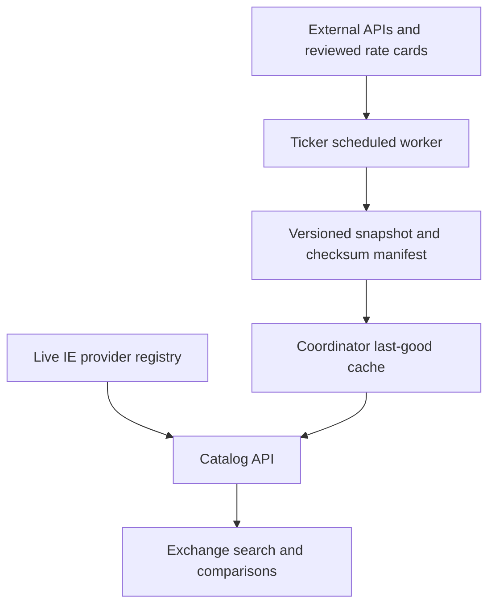

# Exchange catalog PRD and architecture

Owner: Inference Exchange project owner. Tracking: #269.
Status: implementation for alpha review. Scope approved in the issue request.

## Problem and outcome

IE starts with limited provider supply. Developers need a useful model and price catalog before IE serves every model. The Exchange must show collected external models and live IE offers. A model-availability filter must reveal IE supply without hiding competitors for the selected model.

Success means a developer can find a model, compare advertised input, cache-read, and output rates, identify a usable IE offer, and inspect the observation dates. External listings do not establish executable liquidity or OCIP verification.

## User experience

- Default to all models in the published catalog plus live IE models.
- Search model names and exact source IDs. Paginate at 100 models.
- Filter to models with an admitted, non-quarantined IE provider online.
- Keep all external offers when that filter is active.
- Display IE provider count separately from external offers.
- Show source links, route, quantization, context, and observation time.
- Display zero as Free. Display null as Not published.
- Select one IE offer and one named competitor for all three savings columns.
- Permit negative savings. Do not suppress a more expensive IE offer.
- Require an exact model mapping, fresh endpoint data, and matching known quantization and context for headline savings.
- Show unknown or incompatible comparisons as Not comparable. Do not imply equal quality.
- Display the last real observation per UTC day for the selected external offer. Use dots. Do not interpolate gaps.
- Keep loading, failed synchronization, empty search, and missing-history states explicit.
- Link to existing Python and JavaScript fallback examples. Their free-model fallback can change the model.

## Scope and exclusions

The first feed is the complete OpenRouter model catalog and its endpoint listings. No family or first-50-model restriction applies. Historical external offers remain visible for up to 90 days with their actual age. This is collected coverage, not a claim to cover every vendor on the internet.

The export also supports reviewed direct rate cards. Rates from old static manifests must not be relabeled as fresh. Each direct card needs a verification timestamp and source URL before inclusion. Direct routes remain distinct from routes through OpenRouter.

This change does not proxy inference or receive consumer upstream keys. It does not add automatic same-model fallback, benchmark-based quality equivalence, or IE price history. It does not import legacy tape history whose identity or provenance cannot be established. Those are follow-up work. The existing ledger and routing policy are unchanged.

## Components and ownership

Ticker plant owns collection and observation history. GitHub Actions runs at minute 17 every four hours. It limits endpoint concurrency to eight. A failed catalog fetch aborts publication. A failed endpoint fetch retains the previous endpoint observation without refreshing its time. Collection publishes one Git commit containing both snapshot and manifest. The legacy tape and new publication workflow share one concurrency group. A failed push cannot publish partial files.

The coordinator resolves main to one commit SHA. It reads the manifest and payload from that immutable commit. It checks the SHA-256 digest, schema, generation, timestamps, identities, prices, and history bounds. It writes a temporary file, flushes it, and replaces the persistent cache before installing the in-memory snapshot. Lower or equal generations cannot replace the cache. File replacement errors leave memory unchanged. Startup loads the last valid local cache. The worker checks every ten minutes. External collection does not run on a page request.

The frontend refreshes the catalog every ten seconds for live IE availability. The history request refreshes every ten minutes. External observation times change only when the collector obtains new source data. Price changes do not require a frontend rebuild or coordinator restart.

## Data contract v1

The payload has `schema_version`, monotonically increasing `generation`, `generated_at`, source status, and `models`.

Each model has a source-qualified exact `id`, display `name`, reviewed `aliases`, and `offers`. Aliases are case-insensitive exact matches. No substring, family, size-only, or fuzzy join is allowed. An unmapped IE model remains a separate model. A reviewer must verify aliases against the actual model version and variant.

Each offer has a stable `id`, `provider`, `route`, `source_url`, `source_type`, `observed_at`, optional quantization and context, decimal-string rates, and history. Rates use USD per million tokens. Null means unavailable or unknown. Zero means a published zero rate. Catalog-level OpenRouter prices are labeled separately and excluded from savings because they do not identify a single endpoint. Additional conditions must be exposed before a route is eligible for a headline comparison.

The history holds at most 90 UTC daily observations per offer. Each point holds its actual observation timestamp and input/cache-read/output rates. Repeated polls on one day replace that day's point with the last observed value. Failed polls add no point. History records advertised rates, not executed transaction costs or the exact instant a vendor changed its price.

`manifest.json` identifies the schema, generation, and payload checksum. The consumer uses a fixed payload filename at the resolved commit. It does not follow a URL supplied by the payload.

## API and security

- `GET /v1/exchange/catalog?q=&ie_only=false&offset=0&limit=100` returns current models and offers. It strips history from list results. Limit is clamped to 1–100. Search is bounded to 200 characters.
- `GET /v1/exchange/catalog/history?model=` returns observed external history for one exact model ID.

Both endpoints are public read-only market data. They expose no account identifiers, prompts, responses, credentials, or private request traces. They are classified in the route inventory test. Existing provider display names are public market information. Claimed OCIP remains labeled as claimed.

Only the configured GitHub repository is read. Repository syntax is constrained. Download hosts are fixed HTTPS GitHub hosts. The payload limit is 64 MiB. Source links must use HTTPS. TLS verification remains enabled. A checksum detects mixed or corrupted data; it does not protect against a compromised authorized publisher. GitHub write access is a trust boundary. User OpenRouter keys remain in the user's environment. A service key, if required for collection, is a ticker Actions secret and never enters exported JSON.

## Freshness and calculations

An external quote becomes stale after 12 hours. A newly published snapshot can contain stale offers. Publication time must not replace observation time. Stale offers remain visible but do not qualify for savings.

Savings for each dimension equal `(external - IE) / external * 100`. The selected IE endpoint supplies all three rates. A zero external denominator produces an explicit free-price result. Missing data produces no percentage. Percentages describe listed token rates only. Credit purchase fees, cache-write costs, request fees, and workload-specific costs are not included. The UI must not call this total bill savings.

## Deployment and rollback

1. Merge and run the ticker Publish Exchange catalog workflow.
2. Confirm `data/exchange/manifest.json` and `snapshot.json` exist on ticker main.
3. Set `IE_TICKER_REPOSITORY=qzyu999/inference-exchange-ticker-plant` on the coordinator.
4. Set `IE_TICKER_CACHE_PATH` to a writable file on the coordinator's persistent volume. Default is `~/.inference-exchange/ticker-cache.json`.
5. Deploy the coordinator and web build. Restart the coordinator once for configuration changes.
6. Check `/v1/exchange/catalog` for a nonzero generation and a recent generated_at.
7. Check source observations, IE-only filtering, and history in the browser.
8. Temporarily block the publication source in staging. Confirm last-good prices remain visible and sync_error becomes non-null.
9. Restart in staging without source access. Confirm the saved generation loads.

When the ticker repository is configured, disable the legacy coordinator collector automatically. Existing legacy API routes remain for compatibility but the new Exchange uses the catalog API. Without a publication, show live IE offers and an explicit external-data empty state.

To stop synchronization, unset IE_TICKER_REPOSITORY and restart. The last saved data remains available and ages naturally. To roll back a bad publication, publish corrected data with a higher generation. Do not lower the generation or silently delete the local cache. Back up the cache before an intentional reset.

## Operational limits and evolution

GitHub scheduled runs are best-effort. Do not promise a four-hour SLA. Monitor workflow failures, endpoint failure counts, generation age, and coordinator sync warnings. Alerting transport is not configured by this PR. Use workflow notifications initially.

Git keeps growing historical versions. This alpha uses a bounded 90-day payload with a 64 MiB hard publication/download limit. Move payloads to object storage before that limit or repository growth becomes material. Preserve the same immutable-version and publish-last-manifest contract. A future SQLite worker on ephemeral runners must restore and persist its database on every run. Do not add a database without this recovery path.

The coordinator holds one snapshot in memory. Catalog reads scan it and return at most 100 models. History returns at most 90 points per retained offer. Move to indexed storage and per-model history exports when measured latency or payload size requires it.

## Verification plan

| Layer | Verification |
| --- | --- |
| Producer | Full source identity, free/unknown values, daily history, failed endpoint retention, direct-card provenance |
| Consumer | Digest, immutable commit reads, mixed-generation rejection, malformed data, duplicate IDs/aliases, future dates, finite nonnegative rates |
| Durability | Atomic replacement, failed disk write, restart, monotonic generation, retained last-good data |
| Catalog | Exact aliases, version separation, IE-only filtering retains competitors, stale marking, pagination |
| UI | Savings arithmetic, missing/free prices, incompatible/stale comparisons, empty-filter recovery, production build |
| Access | Public read-only routes remain classified; full existing auth and privacy suite |
| Formal | TLC explores publication, download, validation, persist, install, crash, and failure interleavings |

TDD starts with committed producer and consumer contract tests. Record failing baseline and passing implementation commands in the PR. Add regressions before fixing defects found during review. CI runs Python, web, requirements, and TLC checks.

The TLA+ model abstracts a complete validated payload as a generation. It checks complete publication, complete durable/visible snapshots, durable-before-visible installation, and no durable rollback. It permits stale downloads, crashes, and arbitrary failures. TLC explores three generations. It proves these safety properties only for this finite abstraction. It does not prove parser correctness, filesystem power-loss behavior, GitHub availability, provider truth, alias correctness, or liveness under permanent failures. Tests cover the refinement boundary. See `formal/ticker/README.md`.

## Verification record

- Producer and consumer contract tests were committed before their implementations.
- Review regressions failed for alias removal, a 91-point retention boundary, malformed root shapes, and injection of coordinator-owned fields. They pass after fixes.
- Live OpenRouter collection returned 461 models and 1,959 offers. All endpoint fetches succeeded. The complete payload passed consumer validation. These counts are observations from the development smoke test, not catalog coverage guarantees.
- OpenRouter automatic routes returned -1 for dynamic rates. The adapter converts this sentinel to unknown, not free. A failing regression was added before this fix.
- TLC 1.8.0 explored 3,030 transitions/states generated and 361 distinct reachable states at a three-generation bound. All six configured safety invariants passed.
- The negative control removed the newer-generation guard. TLC reported a NoRollback violation.
- A real Chromium browser test covers the IE filter, retained competitor rows, three savings columns, keyboard model selection, empty-search recovery, observed history, and a 390-pixel viewport. It exposed a mobile overflow defect. The corrected layout passed.
- CI runs the browser test, TLC, producer tests, consumer tests, existing web checks, and the requirements checker. The PR records final counts and check links.

The browser test uses synthetic prices with explicit fixture names. The separate live smoke test checks the actual collector/consumer boundary. Neither test sends inference requests or spends API credits.
