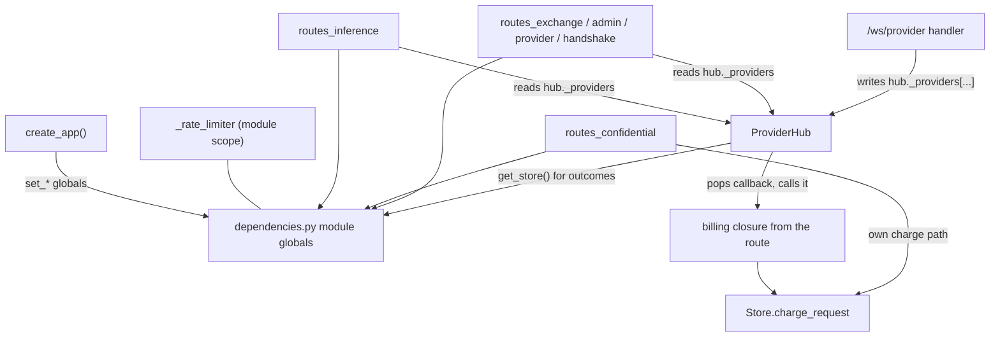
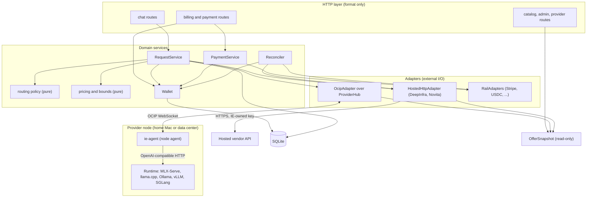
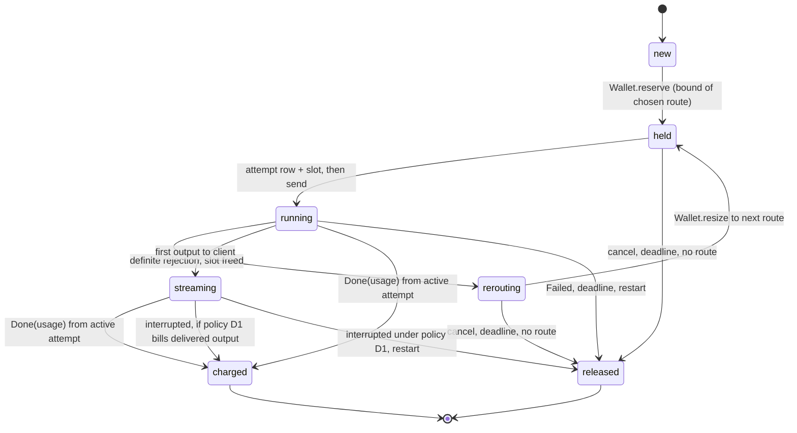
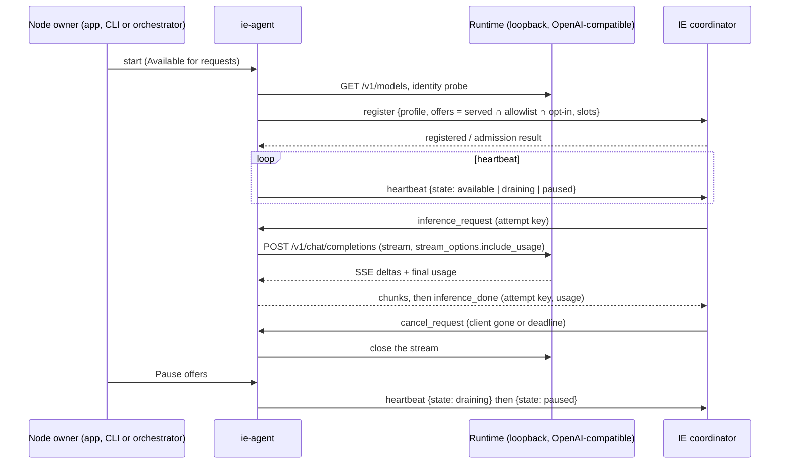
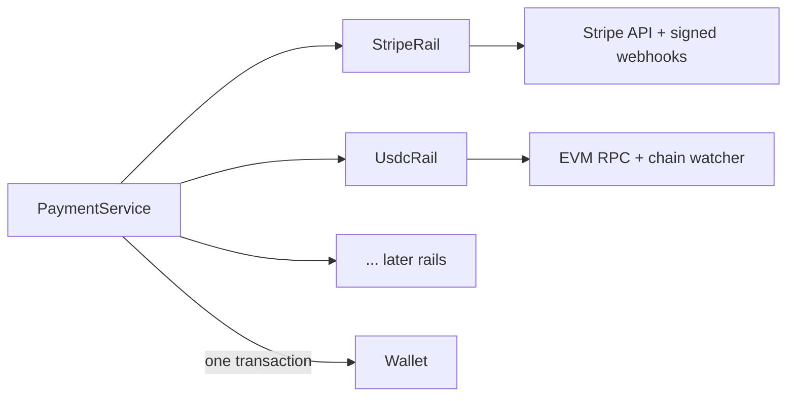
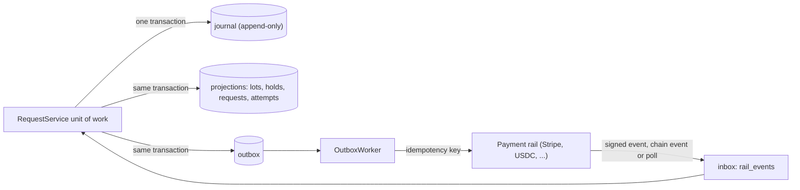
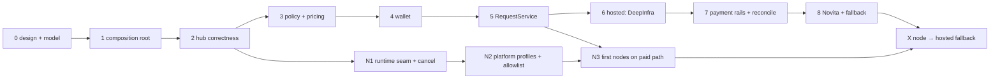

# Paid path architecture

Status: proposal for owner review. Issues: #297 (release gate), #300 (findings audit), #292 (hosted connector), #145 (recovery). Node supply example: [mlx-serve #1](https://github.com/qzyu999/mlx-serve/issues/1).

Baseline: `main` at `e7d4e90`. This document does not change a requirement. Section 10 lists the requirement changes that the owner must approve.

## 1. Summary

The coordinator stays one FastAPI process with one SQLite database (decision 0004). The change is inside the process. Today one request crosses five owners: the route handler, `ProviderHub`, an in-memory billing callback, `Store`, and module globals. No owner has the full request state. The defects in #300 come from this split.

The design gives each paid request one owner and gives money one owner:

- `RequestService` owns the request lifecycle: eligibility, attempts, fallback, and the end state.
- `Wallet` owns money: funding lots, holds, charges, releases and refunds. Each command is one SQLite transaction.
- Adapters own external I/O: the OCIP WebSocket hub, a hosted HTTP vendor, and one rail adapter per payment rail (Stripe first, then USDC; section 6.3). An adapter cannot change a balance.
- A composition root builds these objects for each app instance. No route reads a module global or a private hub field.
- SQLite is the one source of truth. Every component can crash and restart, then rebuild its state from SQLite. Every failure boundary has a stated durable state, recovery action and client-visible outcome (section 8). The coordinator stays one deployable process for now. Section 8.11 says when to split it.

Supply comes from two directions (section 5). Nodes run the IE node agent in front of any OpenAI-compatible runtime: a home Mac with MLX-Serve, a workstation with llama.cpp or Ollama, or a data-center pool with vLLM or SGLang. Hosted vendors such as DeepInfra and Novita do not run IE software, so a connector in the coordinator calls them. Both are `Offer`s behind the same adapter contract. The request lifecycle and the wallet are the same for both. The differences are explicit: consent, trust, who is paid, and what IE must reconcile.

A TLA+ model (`formal/paid/PaidPath.tla`) states the invariants for both directions. TLC checks them and 21 negative controls. Section 7 maps each model step to a service method, a SQL guard and a test.

## 2. Current dependencies



The problems that this structure causes:

| Problem | Source at `e7d4e90` | Effect |
|---|---|---|
| State is process-global | `dependencies.py` `set_*`, `_rate_limiter = RateLimiter()` | A second `create_app()` replaces the store and hub of the first. Limiter state crosses app instances and tests. |
| Hub internals are public in practice | `hub._providers` is read in 7 modules, written in `main.py` | A change to provider state changes routes, admin and catalog. |
| Selection exists three times | `select_provider` (immediate), `_try_dispatch_queued`, retry in `_route_and_dispatch` | Immediate passes reputation and affinity. Queue omits reputation. Retry omits both. |
| Dispatch exists twice | queue branch and immediate branch of `_route_and_dispatch` | Each branch builds its own encryption, trace, callback and response. |
| Billing is a side effect of a frame | `handle_provider_message` pops the callback and calls `Store` | The send happens before the callback exists. A frame is not checked against its sender. A billing error does not change the HTTP result. |
| Money has no request key | `idx_transactions_request_id` is not unique | A repeated charge for one request ID debits twice. |
| Usage has two sources | `_collect_response` counts chunks; the callback uses `tokens_generated` | The API usage and the bill disagree. The bill is not bounded by `max_tokens`. |

## 3. Proposed layout



Dependency rules. A test can check each rule with an import scan in CI.

1. HTTP modules import services. They do not import adapters, `Store` or `ProviderHub`.
2. `policy` and `pricing` are pure functions. They import nothing that does I/O.
3. Only `Wallet` functions write money tables. Only `RequestService` writes request and attempt tables. Only `PaymentService` writes payment, refund and outbox rows. The handler of a command opens its one transaction and passes it to `Wallet` (section 8.2).
4. Adapters do not import `Wallet`. They return events. The service decides what an event does.
5. No module-level mutable state. The composition root creates every stateful object.

### 3.1 Files

New code goes in a new package. Existing files move only when a slice in section 9 needs them.

```
inference_exchange/coordinator/
  composition.py          Services dataclass; build_services(config) -> Services; stored on app.state
  paid/
    model.py              Order, Offer, Candidate, Quote, Bound, Usage, AttemptEvent (frozen dataclasses)
    policy.py             eligible(order, offers) -> list[Candidate | Rejection]; rank(...) (pure)
    pricing.py            quote(offer), bound(order, quote), charge(usage, quote) (pure; uses shared/money.cost_micro)
    wallet.py             Wallet: credit_payment, reserve, resize, settle, release, hold_refund, finish_refund
    requests.py           RequestService: admit, run, on_event, recover
    reconcile.py          Reconciler: one loop; resolves uncertain attempts, stale refunds, ledger drift
    payments.py           PaymentService: create_funding, handle_event, request_refund (rail-agnostic)
    schema.py             additive DDL and migration checks for the paid tables
  adapters/
    base.py               ExecutionAdapter protocol
    ocip.py               OcipAdapter: wraps ProviderHub; binds frames to (request, attempt, session)
    hosted_http.py        HostedHttpAdapter: one OpenAI-compatible client, configured per vendor
    rails/
      base.py             RailAdapter protocol, RailEvent, RailCapabilities
      stripe.py           StripeRail: Checkout, refunds, webhook signature check
      usdc.py             UsdcRail: payment requests, chain watcher, refund transfers
  supply/
    allowlist.py          Allowlisted model packs: exact repo, revision, format, quantization, digest
    offers.py             Offer construction for both directions; one Offer type, one eligibility input

ocip_agent/
  runtimes/
    base.py               Runtime protocol: health, models, identity, chat_stream, cancel
    openai_compatible.py  attach to a running server by URL; never spawn or stop it
                          (MLX-Serve, llama-server, Ollama, vLLM, SGLang, LM Studio)
    managed_llama.py      current behavior: spawn llama-server, then use openai_compatible
```

`ie-provider` and its in-process llama-cpp-python engine stay as they are until `ie-agent` passes the same contract test. Then `ie-provider` becomes a thin wrapper or is withdrawn. Its in-process engine cannot serve a runtime that it does not embed.

`ProviderHub` stays the WebSocket transport. It gets three changes and loses its billing role:

- `snapshot() -> tuple[OfferView, ...]`: immutable views for routing, catalog, admin and handshake. Routes stop reading `_providers`.
- `start(attempt_key, session_id, request)`: claims a slot and installs the response queue before the send.
- `handle_provider_message` drops a frame unless its sender session matches the attempt. The callback table goes away.

### 3.2 Adapter contract

```python
class ExecutionAdapter(Protocol):
    def offers(self) -> Sequence[Offer]: ...
    async def run(self, attempt: AttemptKey, req: NormalizedRequest) -> AsyncIterator[AttemptEvent]: ...
    async def cancel(self, attempt: AttemptKey) -> None: ...
```

`AttemptEvent` is one of `Accepted`, `Output(text)`, `Done(usage)`, `Rejected(definite: bool, reason)` and `Failed(reason)`. `Rejected(definite=True)` is only for a failure before the upstream accepted the call. Each adapter documents which upstream errors are definite. All other errors are `Failed`. The service treats `Failed` as an ambiguous acceptance.

### 3.3 Composition root

`create_app()` calls `build_services(config)` once and stores the result on `app.state.services`. Routes get services through a FastAPI dependency that reads `request.app.state`. The rate limiter, operator controls, trace store and event bus move into `Services`. `dependencies.py` stays as a thin shim for unmigrated routes until slice 1 is complete. Then it is deleted.

## 4. Request lifecycle



Rules:

1. **Admit.** Resolve the caller, model, trust minimum, allowed locations (community, hosted) and price ceiling. `policy.eligible` filters on exact model revision, precision, features, location consent, trust evidence, ceiling and capacity. It returns a reason for each rejection (ROUTE-010). Then `policy.rank` orders the candidates with a deterministic tie-break. Immediate, queued and fallback selection use the same two functions. Section 5.3 gives the order between local and hosted candidates.
2. **Reserve.** `pricing.bound` computes the maximum charge: the input token bound at the highest input rate, plus `max_tokens` at the output rate, and not less than the minimum charge. `Wallet.reserve` checks available funds and writes the hold in one transaction. If funds are not sufficient, the response is HTTP 402 before any dispatch.
3. **Dispatch.** In one transaction, write the attempt row (`request_id`, `attempt_no`, `route_id`, `session_id`, `dispatch = 'intent'`). From this commit the attempt is possibly sent (section 8.4). Then take the slot and send. A frame is accepted only if it matches all three keys.
4. **Fallback.** Only after a definite rejection before output. Free the slot, run `eligible` again with the failed routes excluded, and call `Wallet.resize`. Trust and ceiling do not change (ROUTE-008, P1). After the first output byte, there is no fallback.
5. **Finish.** `Wallet.settle` debits `min(charge(usage), hold)`, releases the remainder, writes the receipt and marks the request `charged`, in one transaction. The transaction is a compare-and-set on `phase` and `active_attempt`. A late, duplicate or foreign `Done` changes zero rows and has no effect. The HTTP response and the receipt use the same `Usage` object. For streaming, the receipt chunk and the final `[DONE]` marker are sent after the commit (section 8.5). Usage that fails validation is not charged (section 8.6).
6. **Fail.** On `Failed`, a deadline, or a client disconnect: release the hold and free the slot. If the attempt went to a hosted vendor, add a reconciliation item for the possible vendor cost. A community provider is paid only through a charge, so a failed local attempt leaves no item.
7. **Recover.** At startup, every live request becomes `released`. Every possibly-sent hosted attempt without a result becomes a reconciliation item. Committed charges and pending refunds stay. Every provider registers again.

Telemetry (traces, reputation, TPS, country activity, event bus) runs after the commit and cannot change the result. An exception in telemetry is logged and ignored.

## 5. Supply from two directions

IE bootstraps supply from two sides at once:

- **Nodes (community and operators).** A provider runs the IE node agent next to an inference runtime that they already operate. This covers a home Mac with MLX-Serve ([mlx-serve #1](https://github.com/qzyu999/mlx-serve/issues/1)), a workstation with llama.cpp or Ollama, and a data-center operator with vLLM or SGLang. All of them use the same agent, protocol, admission and payout path. Supply grows one node at a time. A node can pause at any time and earns credits.
- **Hosted (vendors).** IE calls a vendor such as DeepInfra or Novita with an IE-owned credential (#292). The vendor runs no IE software. Capacity is large and always on. IE pays the vendor's invoice and charges the customer.

Hosted supply serves strong models from day one. Node supply grows into the same catalog. A model that both directions serve can run on a node first and fall back to a vendor when the customer allows it.

The split is by who is paid, not by where the hardware is. A data center that runs the IE agent is a node: it earns provider credit and its trust comes from IE admission. A data center that IE buys from by API is a hosted vendor: IE pays its invoice and its trust is `external`.

### 5.0 Current state: explicit, not agnostic

At `e7d4e90`, every layer names one runtime:

| Layer | Today | Effect |
|---|---|---|
| `ie-provider` | runs llama-cpp-python in-process, or a mock engine | serves only GGUF models that it loads itself |
| `ie-agent` | always spawns its own `llama-server` child, then speaks OpenAI HTTP to it | the HTTP half is generic; the agent cannot attach to a server that someone else runs |
| Registration | production rejects any hardware that does not match `apple-…` and any `model_format` other than `gguf` | a Linux vLLM node or an MLX pack cannot register |
| Enrollment | one fixed profile, `apple-silicon-macos-gguf-metal-l0` (PROV-018) | a new platform needs a new code path |
| Hosted | not built (#292) | n/a |

The design below makes the connector agnostic. It does this with three seams, in the Kubernetes style: a control plane, a node agent and a runtime interface.

| Kubernetes | IE | Owner |
|---|---|---|
| API server + scheduler | coordinator: `policy.eligible` filters, `policy.rank` scores | IE |
| kubelet | `ie-agent` node agent: register, heartbeat, run, cancel, report usage | IE |
| CRI (container runtime interface) | `Runtime` protocol, OpenAI-compatible HTTP first | IE defines; the runtime project implements nothing new |
| Node labels, capacity, conditions | `Offer`: model identity, platform, slots, `state` | agent reports; coordinator verifies |
| Cordon and drain | `paused`, `draining` | node owner |
| Taints and tolerations | trust minimum and location consent | customer and IE policy |
| Admission controllers | allowlist + profile check at registration | IE |
| External service | hosted connector in the coordinator | IE |

A runtime project such as MLX-Serve needs no IE code. It exposes an OpenAI-compatible API on loopback. The IE agent does the rest.

### 5.1 One offer type

Both directions produce the same `Offer`. Routing, pricing, holds and settlement read only the `Offer` and never test the transport.

| Field | Node (home Mac or data center) | Hosted (vendor) |
|---|---|---|
| `route_id` | provider billing principal + model | vendor + vendor model ID |
| `location` | `community` | `hosted` |
| `model` | allowlisted pack: repo, revision, format (`gguf`, `mlx`, `safetensors`), quantization, digest | allowlisted mapping: IE model ID → vendor model ID and stated precision |
| `platform` | profile ID from registration, for example `macos-arm64-mlx`, `macos-arm64-gguf`, `linux-cuda-vllm` | `hosted` |
| `trust` | admitted level from evidence (PROV-004); L0 in the pilot | `external` (unattested); never above `open` (D4) |
| `rates` | provider's manual rates, IE auto rates (D10) or explicit free | vendor list rate + IE margin, captured in the quote |
| `capacity` | slots the agent declares (1 for a home Mac, N for a pool); `available`, `draining`, `paused`, `offline` | vendor limit and IE pilot budget |
| `payee` | provider billing principal (BILL-010) | none; vendor cost is an attempt record |
| `adapter` | `OcipAdapter` | `HostedHttpAdapter` |

An offer exists only when both IE and the supplier allow it. For a node, that is served by the runtime ∩ IE allowlist ∩ owner opt-in. For a vendor, that is the IE allowlist ∩ vendor catalog ∩ IE pilot budget.

### 5.2 Node supply: one agent, any runtime

The node agent (`ie-agent`) is the only IE software on a provider machine. It holds the IE provider credential, keeps one outbound WebSocket to the coordinator, and talks to the runtime over loopback HTTP. The runtime does not know about IE.



The runtime contract is small and is already the OpenAI chat API:

| Need | Runtime provides |
|---|---|
| Model list | `GET /v1/models` |
| Inference | `POST /v1/chat/completions` with SSE streaming |
| Usage | final usage object (`prompt_tokens`, `completion_tokens`, and cached tokens if known) |
| Cancel | the agent closes the HTTP stream; the runtime stops the generation |
| Identity | an identity probe per format: GGUF header, MLX or safetensors pack revision and file digests, or a served model name mapped to a pack |
| Health | `GET /health` or a successful `GET /v1/models` |

A runtime that does not report usage is not eligible for the paid path. Billing must not fall back to a chunk count.

Changes on the IE side:

1. **Runtime seam in the agent.** `ocip_agent` gets a `Runtime` protocol. `openai_compatible` attaches to a running server by URL and never starts or stops it, because the node owner owns that lifecycle. The current behavior becomes `managed_llama`: spawn `llama-server`, then use `openai_compatible`. Identity probes are per format. They are not per runtime product.
2. **Platform profiles, not one hard-coded profile.** Replace the `apple-…` hardware match and the `gguf` format check in `provider_registration.py` with a table of admitted profiles. Each profile states the platform, the model formats, the identity check and the highest trust level. Start with `macos-arm64-gguf-l0` (today's profile, renamed by alias) and `macos-arm64-mlx-l0`. Add `linux-cuda-l0` for operators later. Each new profile is one row and one requirement change (D8), not a new code path.
3. **Slots and state.** The agent declares slots. A home Mac declares 1. A pool declares its real concurrency. `HeartbeatMessage` gets an explicit `state` field. `draining` and `paused` stop new dispatch without counting as a crash or a reputation fault. The coordinator keeps its own slot count (slice 2). It does not copy `active_requests` from the heartbeat.
4. **Cancel on the wire.** The coordinator sends `cancel_request` when a client disconnects or a deadline passes. Today it never does. The agent closes the runtime stream.
5. **Allowlist.** `supply/allowlist.py` lists exact packs with commercial-use status, modality, formats, and tested memory and context limits. A provider's claim of a model is a claim (P3). The identity check makes it a checked claim at L0. It is not evidence of L2.
6. **Rates.** Manual rates are bound at the quote (BILL-013 precision). Free mode is an explicit flag, not three zero prices. The agent CLI today uses a zero cache price to mean "same as input" (D9).
7. **One agent.** `ie-provider` keeps working until `ie-agent` passes the runtime contract test with `managed_llama` and the mock. Then `ie-provider` becomes a thin wrapper or is withdrawn.

Data-center operators use the same agent. They run one agent per pool in a container next to their vLLM or SGLang service and declare N slots. The agent is stateless apart from its credential, so a Kubernetes Deployment, a systemd unit and a Mac login item are all valid ways to run it. IE does not schedule the operator's GPUs. The operator's own scheduler does that. IE sees one node with N slots.

#### Integration examples

| Runtime | How it connects | Runtime-side work |
|---|---|---|
| MLX-Serve (mlx-serve #1) | the MLX-Serve app starts `ie-agent` as a sidecar with `--runtime-url` | an app toggle and status view; a restricted local credential for the agent |
| llama.cpp | `managed_llama`, or `openai_compatible` to a running `llama-server` | none |
| Ollama, LM Studio | `openai_compatible` to their OpenAI endpoint | none |
| vLLM, SGLang | agent container next to the service | none |

The mlx-serve proposals add their own rules on the runtime side. The agent's local credential is separate from the IE provider credential. The local access boundary must apply to every agent request, including loopback. Prefer local and Prefer offers change admission order, not a running job. The app makes no IE network calls when the offer is off. These rules apply to any desktop runtime that embeds the agent. IE depends on them but does not enforce them. At L0 the coordinator and the node both see plaintext. Every UI must show L0 until IE admits a higher level from evidence.

### 5.3 Routing across the two directions

The request carries one location policy. The policy comes from an explicit field or the account default. It is never inferred.

| Policy | Candidates | Fallback |
|---|---|---|
| `node_only` | community offers | another community offer only |
| `node_preferred` | community offers first, then hosted offers if the request consents | to hosted only with consent, only before output, same exact model |
| `hosted_only` | hosted offers | another vendor |

`policy.eligible` filters both directions with the same rules: exact model and revision, precision, features, trust minimum (hosted counts as `open`), price ceiling and capacity. `policy.rank` orders within each tier. Location order comes from the policy, not from the score, so a cheap hosted route never jumps ahead of an eligible node under `node_preferred`. The model checks that no attempt reaches a hosted route without consent (`NoHostedWithoutConsent`), on the first choice and on fallback.

Fallback from a node to a vendor uses the same `Resize` step. The hold changes to the vendor's bound in one transaction. If funds do not cover the dearer bound, the request is released with HTTP 402 and no vendor call is made.

### 5.4 What differs at settlement

| | Node | Hosted |
|---|---|---|
| Customer charge | `min(charge(usage), hold)` | same |
| Split | provider earning + platform fee (BILL-001, BILL-002) | platform revenue; no provider credit |
| Failed or interrupted attempt | no payment to the provider; no reconciliation item | possible vendor cost; reconciliation item |
| Usage source | agent from the runtime's final usage object, capped by the hold | vendor's usage object, checked against the vendor report |
| Earnings | simulated credits until a payout requirement exists (BILL-011) | n/a |

The model checks the split (`BooksBalance`, `EarningsOnlyFromLocal`) and checks that every sent hosted attempt without a confirmed result reaches reconciliation (`HostedCostTracked`). Cash payout to node owners is out of scope for #297. It needs its own earnings-to-payout reconciliation before it ships.

### 5.5 Media jobs

Runtimes such as MLX-Serve also serve images, audio, video and 3D. The current OCIP request is chat messages, text chunks and token counts. The provider WebSocket caps a message at 1 MB. A media job is a separate job type with its own price unit (for example per image at a stated resolution, or per second of audio). It uses the same `Offer`, hold, attempt and settlement. Its output is an encrypted artifact that the client downloads, not a stream of frames. It is out of scope for the paid alpha. The `RequestService` and `Wallet` contracts do not assume tokens, so a media job adds a pricing function and an artifact path, not a second lifecycle.

## 6. Money

### 6.1 Units and tables

IE amounts are integer micro-USD. Each payment rail converts its own unit at its boundary (section 6.3).

| Table | Key constraints |
|---|---|
| `funding_orders(order_id, account_id, rail_id, amount_micro, rail_amount, currency, rate, status, expires_at)` | `PRIMARY KEY(order_id)`; one order per funding attempt |
| `funding_lots(lot_id, account_id, kind, rail_id, rail_ref, order_id, amount_micro, remaining_micro)` | `kind IN ('sponsored','paid')`; `UNIQUE(rail_id, rail_ref)`; `CHECK(remaining_micro >= 0)` |
| `paid_requests(request_id, account_id, phase, location_policy, route_id, active_attempt, quote, hold_micro, charge_micro, idempotency_key)` | `CHECK(phase IN (...))`; `UNIQUE(account_id, idempotency_key)` |
| `hold_allocations(request_id, lot_id, amount_micro)` | `PRIMARY KEY(request_id, lot_id)`; rows exist only while the request is live |
| `attempts(request_id, attempt_no, route_id, location, session_id, sent_at, result, upstream_cost_micro)` | `PRIMARY KEY(request_id, attempt_no)` |
| `ledger_entries(entry_id, account_id, lot_id, request_id, refund_id, kind, amount_micro)` | `UNIQUE(request_id) WHERE kind = 'charge'`; `UNIQUE(refund_id) WHERE kind = 'refund'` |
| `refunds(refund_id, account_id, lot_id, rail_id, amount_micro, phase, rail_ref, destination)` | `UNIQUE(rail_id, rail_ref)`; lot `rail_id` = refund `rail_id` |
| `rail_events(rail_id, rail_event_id, type, order_id, rail_ref, received_at, status)` | `PRIMARY KEY(rail_id, rail_event_id)` |
| `rail_cursors(rail_id, cursor)` | `PRIMARY KEY(rail_id)`; polling position per rail |
| `reconciliation_items(request_id, attempt_no, reason, status)` | `PRIMARY KEY(request_id, attempt_no)` |

The migration is additive. Legacy `accounts` and `transactions` rows stay unchanged (BILL-010, BILL-012). A node charge still credits the provider billing principal through `ledger_entries`. The legacy community path keeps `charge_request` until slice 5 moves it.

Derived values:

- `available(account) = SUM(remaining_micro) - SUM(active hold_allocations) - SUM(pending refunds)`
- `refundable(account) = SUM(remaining_micro of paid lots) - holds on paid lots - pending refunds`

### 6.2 Conservation

For each account, with `credits` the confirmed payments on all rails and `grants` the sponsored credit:

```
remaining(paid lots)      + charges on paid lots      + succeeded refunds = credits
remaining(sponsored lots) + charges on sponsored lots                     = grants
```

For all charges:

```
sum(charges) = sum(provider earnings on node charges) + platform fees + hosted revenue
```

For each node charge (P7, BILL-001):

```
consumer charge = provider credit + platform fee
```

For a hosted charge, the platform keeps the customer charge as revenue. The vendor cost is a separate amount on the attempt row. `Reconciler` compares the vendor cost with the vendor report. The margin can be negative. It is a reported number, not a balance.

Reported usage above the hold is not charged. The excess goes in the attempt row and, for a hosted attempt, in a reconciliation item (decision D6).

### 6.3 Payment rails

IE takes money in through more than one rail. Stripe Checkout (cards) is the first rail for #297. USDC (#44) is the second. Others, such as bank transfer or another stablecoin, are later rows. The wallet, the ledger and the request path do not know which rail funded a lot. Only `PaymentService` and one `RailAdapter` per rail do.



**Rail contract.** Each rail implements the same small interface. It returns normalized events. It never touches the wallet.

```python
class RailAdapter(Protocol):
    rail_id: str                                       # "stripe", "usdc-base", ...
    def capabilities(self) -> RailCapabilities: ...    # refunds, partial refunds, disputes, finality, unit
    async def create_funding(self, order: FundingOrder) -> FundingInstructions: ...   # idempotency key = order_id
    async def refund(self, refund: RefundOrder) -> RailResult: ...                   # idempotency key = refund_id
    def verify_event(self, raw: bytes, headers: Mapping[str, str]) -> RailEvent | Rejected: ...
    async def poll(self, since: Cursor) -> tuple[list[RailEvent], Cursor]: ...       # for rails without push, and for restore gaps
    async def statement(self, window: TimeWindow) -> RailStatement: ...              # for reconciliation
```

`RailEvent` is one of `FundingConfirmed`, `FundingFailed`, `RefundSucceeded`, `RefundFailed`, `DisputeOpened`, `DisputeClosed` and `Reversed`. Each event has a `rail_id`, a `rail_event_id` (unique per rail), a `rail_ref` (the payment, transfer or refund on that rail), the `order_id` it belongs to, an amount in the rail's minor unit, and a currency or asset.

**Normalization at the boundary.** IE amounts are integer micro-USD everywhere inside IE. A rail converts at its own boundary and states the rule:

| Rail | Rail unit | To micro-USD | Rounding |
|---|---|---|---|
| Stripe (USD) | cents | × 10,000 | exact |
| USDC | 10⁻⁶ USDC (the token's 6 decimals) | × 1, at a fixed 1 USDC = 1 USD for credit (D18) | exact |
| other | its minor unit | stated per rail; a quoted rate is captured on the order | down for credit, down for refund |

A non-USD rail captures its rate on the `FundingOrder`. The credit uses that captured rate, not the rate when the event arrives.

**What differs between rails.**

| Property | Stripe | USDC |
|---|---|---|
| Who starts funding | IE creates a Checkout session | IE gives the customer a deposit address or a payment request bound to the order |
| Confirmation | signed webhook, plus polling | chain watcher after N confirmations (finality rule per chain), plus polling |
| Idempotency for IE calls | Stripe idempotency key | the order ID is bound into the payment request; a refund is a transfer that IE signs once and records by transaction hash before it is broadcast |
| Refunds | to the original payment method, partial allowed | a transfer to an address the customer proves they control; never to an address taken only from the payment |
| Disputes and reversals | chargebacks | none after finality; a reorg before finality is `Reversed` |
| Fees | processor fee on the statement | network fee paid by IE on refunds |
| Statement for reconciliation | balance transactions | chain transfers to and from IE addresses |

**Ledger rules for every rail.**

- A funding lot records `rail_id` and `rail_ref`. `UNIQUE(rail_id, rail_ref)` makes a payment credit once.
- A refund draws only on paid lots of the same rail, and the rail must have `refunds` in its capabilities. A card payment is not refunded in USDC, or the other way round, unless the owner approves a rule for that (D19).
- `FundingConfirmed` credits only an amount that matches the order, in the order's currency or asset. An underpayment or overpayment is held as a reconciliation item, not credited automatically (D19).
- `DisputeOpened` or `Reversed` moves the disputed amount into a hold on the lot. If the lot has already been spent, the account goes into a recorded negative position, and paid admission for that account stops until it is resolved. It never takes money from another account.
- Processor fees and network fees are platform costs on the statement. They never change a customer balance.

**Durability and restore.** The inbox table is `rail_events(rail_id, rail_event_id, ...)` with `PRIMARY KEY(rail_id, rail_event_id)`. Each rail has a polling cursor in SQLite. After a restore (section 8.7), each rail is polled from its cursor minus a margin. A chain rail is replayed from a block height. It does not depend on webhook redelivery.

**Adding a rail.** A new rail is one adapter, one row in the rail table, the conversion rule, the refund rule, a fake for the failure tests in 7.3, and a requirement change. No change to `Wallet`, `RequestService` or the model is needed. The model's `CreditPayment`, `SendRefund` and `FinishRefund` steps are rail-agnostic. They need only event-ID deduplication and an idempotent refund, which every rail must provide.

## 7. Formal model and refinement

### 7.1 Model

`formal/paid/PaidPath.tla` models two requests (one with hosted consent), a node route (one slot that can pause, drain and go offline) and a hosted route (one slot, more expensive), two attempts per request, one payment, one sponsored grant and one refund. Any route can send a frame for any request. Usage reports can be larger than any hold. `Restart` deletes all memory state, keeps SQLite state and disconnects the node.

In the model, route `"local"` stands for any node. The model does not depend on the runtime behind it.

Result on this branch, TLC 1.8.0, Java 17:

| Run | Result |
|---|---|
| Base model, `BillInterrupted = FALSE` | No violation. 136,861 distinct states. |
| Base model, `BillInterrupted = TRUE` | No violation. 162,061 distinct states. |
| 21 negative controls | Each control produces a counterexample for its property. |

The controls are in `formal/paid/check.py`. CI runs the script in the existing `Ticker verification` workflow.

| Control (guard removed) | Property that fails |
|---|---|
| Reserve without funds check | `NoOverspend` |
| Resize without funds check | `NoOverspend` |
| Refund can use sponsored credit | `NoOverspend` |
| Stale attempt accepted | `OnlyActiveAttemptSettles` |
| Frame from a foreign provider accepted | `OnlyActiveAttemptSettles` |
| Duplicate completion settles again | `TerminalStable` |
| Usage not capped by the hold | `ChargeWithinAuthorization` |
| Failure keeps the slot | `SlotsExact` |
| Dispatch ignores capacity | `SlotsWithinCap` |
| No reconciliation worker | `UncertainResolved` |
| No request deadline | `RequestsFinish` |
| Hosted fallback without consent | `NoHostedWithoutConsent` |
| Dispatch to a paused node | `PausedIdle` |
| Pause without drain | `PausedIdle` |
| Hosted charge credits a provider | `EarningsOnlyFromLocal` |
| Hosted failure leaves no reconciliation item | `HostedCostTracked` |
| Rail call without idempotency key | `RefundExactlyOnce` |
| Rail called before the intent is durable | `ProcessorEffectHasIntent` |
| Outbox kept in memory | `RefundResolves` |
| Vendor called before the attempt row commits | `CalledWasRecorded` |
| Restart forgets possibly-sent hosted attempts | `CalledCostTracked` |

Limits. The result applies to these bounds only. The model does not check Python code, SQLite, payment rails, vendors, node runtimes, the agent's local access boundary, timing, prices, trust evidence or tokenizer accuracy. Liveness assumes that the deadline, the reconciler, the outbox worker and the refund poller run (weak fairness). The refund path models the outbox (section 8.3): the worker can call the processor again after a crash, and the processor applies each idempotency key once. The hosted call is a separate step after the dispatch commit (`CallVendor`), so the model covers a crash between them (section 8.4). The tests in 7.2 and 7.3 check the implementation.

### 7.2 Refinement table

| Model step or property | Service method | SQL guard | Regression test (to write) |
|---|---|---|---|
| `CreditPayment` | `PaymentService.handle_event` → `Wallet.credit_payment` | `rail_events` PK; `UNIQUE(rail_id, rail_ref)` | per rail: duplicate, concurrent and out-of-order events credit one lot; an amount that does not match the order is not credited |
| `Reserve`, `NoOverspend` | `Wallet.reserve` | `BEGIN IMMEDIATE`; available ≥ bound in the same transaction | two threads, one balance: one 402; reserve after restart |
| `Resize` | `Wallet.resize` | replace `hold_allocations` in one transaction | node → hosted fallback fails 402 without leaking the first hold |
| `Allowed`, `NoHostedWithoutConsent` | `policy.eligible` | `attempts.location` checked against `paid_requests.location_policy` | `node_only` and `node_preferred` without consent never call the hosted adapter, including on fallback |
| `HoldRefund` (paid only) | `Wallet.hold_refund` | `refundable ≥ amount`; lot `kind = 'paid'`; lot rail = refund rail | refund cannot use sponsored or held credit, or credit from another rail; refund vs spend race |
| `HoldRefund` outbox write | `Wallet.hold_refund` | `outbox` row in the same transaction as the hold | crash after commit: the worker sends the refund after restart |
| `SendRefund`, `RefundExactlyOnce` | `OutboxWorker` → `RailAdapter.refund` | idempotency key = `refund_id` (Stripe); signed transfer recorded by hash before broadcast (USDC) | crash after the rail call and before its result is written: second call returns the first result; Stripe test mode and a USDC testnet each show one refund |
| `ProcessorEffectHasIntent` | `OutboxWorker` reads only committed rows | worker selects `status = 'queued'` | no adapter call path exists outside the worker (import-rule test) |
| `FinishRefund` | `PaymentService.handle_event` | `UNIQUE(refund_id) WHERE kind='refund'` | failed refund releases the hold; replay is a no-op |
| `Dispatch`, `SlotsWithinCap` | `RequestService.run` → `adapter.run` | attempt row before send | two queued waiters cannot take one slot |
| `LocalPause`, `LocalDrained`, `PausedIdle` | `OcipAdapter` offer state from heartbeat `state` | n/a (memory) | a paused or draining node gets no new job; its running job finishes; pause is not a reputation fault |
| `LocalOffline` | `OcipAdapter` on disconnect | release CAS | runtime stops mid-stream: hold released, no provider credit |
| `Accepts` (frame ownership) | `OcipAdapter` session check | n/a (memory) | a foreign session's `Done` is dropped and not billed |
| `Complete`, `OnlyActiveAttemptSettles`, `TerminalStable` | `Wallet.settle` | `UPDATE paid_requests ... WHERE phase IN ('running','streaming') AND active_attempt = ?`; rowcount 1; `UNIQUE(request_id) WHERE kind='charge'` | repeat `Done`, stale attempt `Done`, `Done` after release: one charge |
| `BooksBalance`, `EarningsOnlyFromLocal` | `Wallet.settle` split | provider entry only when `attempts.location = 'community'` | node charge: earning + fee = charge; hosted charge: no provider entry |
| `ChargeWithinAuthorization` | `pricing.charge` + `Wallet.settle` | `CHECK(charge_micro <= hold_micro)` | `max_tokens=8` with a report of 1,000,000 tokens charges ≤ hold |
| `Fail`, `SlotsExact` | `RequestService` `finally` | release CAS on `phase` | cancel during send frees the slot once and sends `cancel_request`; heartbeat cannot reset slots |
| `Owed`, `HostedCostTracked` | `RequestService` fail path | insert `reconciliation_items` for hosted attempts | hosted timeout, ambiguous acceptance and restart each leave one item |
| `Restart` | `RequestService.recover` at startup | live rows → `released`, one transaction each | F1 to F7 in 7.3 |
| `CallVendor`, `CalledWasRecorded`, `CalledCostTracked` | `RequestService.run` sends only after the dispatch commit | `attempts.dispatch = 'intent'` before the send | F2, F3 in 7.3 |
| `Reconcile`, `UncertainResolved` | `Reconciler` loop | `reconciliation_items` status | each item resolves or alerts within the deadline |
| `Conservation` | all `Wallet` commands | lot `CHECK(remaining_micro >= 0)` | property test of random command sequences on real SQLite checks the equations in 6.2 |
| Usage parity (not in model) | `Usage` object shared by response and receipt | n/a | JSON `usage` equals the ledger entry, for both adapters |
| Runtime parity (not in model) | `ocip_agent` runtimes | n/a | `managed_llama` and `openai_compatible` pass one contract test: usage, cancel, error, finish reason |
| Replay (not in model) | `journal.rebuild()` | journal is append-only; projections have no other writer | rebuild every projection from the journal into an empty database; compare with live tables row by row |
| Node resync (not in model) | `OcipAdapter.on_register` | attempt rows for the node's principal | agent reconnects holding an attempt: coordinator answers finish, cancel or reconcile; a stale attempt is never charged |

The conservation test runs on the real `Store` connection, not on `billing_memory.BillingLedger`.

### 7.3 End-to-end failure injection

These tests run against the real FastAPI app, the real HTTP and SSE path, and a real SQLite file on disk. The node is the mock agent. The vendor is a fake HTTP server that can record calls, delay, return errors and send bad usage. Each payment rail has a fake: a Stripe fake with Stripe's idempotency rules, and a chain fake that can delay confirmations, reorg before finality and replay blocks. A test harness kills the coordinator process with `SIGKILL` at a named point (a fault hook that only test builds enable), then starts a new process on the same file.

Every test asserts the same oracle after it ends:

- conservation (section 6.2) holds on the live tables and on the rebuild from the journal;
- the request has at most one charge, and a charge is never more than its hold;
- no hold row and no slot remains for a terminal request;
- every hosted call that the fake vendor recorded is either the settled attempt or has a reconciliation item;
- the client saw the outcome that section 8.5 states for that stage, and `GET /v1/requests/{id}` agrees with it.

| Case | Fault | Expected outcome |
|---|---|---|
| F1 | kill after the reserve commit, before dispatch | restart releases the hold; lookup shows `released`; no vendor call |
| F2 | kill after the dispatch commit, before the send (hosted) | released; one reconciliation item; the vendor shows no call; the Reconciler marks it "no cost found" |
| F3 | kill after the send, before the first byte (hosted) | released; one reconciliation item; the vendor shows one call |
| F4 | kill after the send (node) | released; on resync the node gets `cancel`; no provider credit |
| F5 | kill during streaming, before `Done` | released under D1; stream ends without `[DONE]` |
| F6 | kill after the settle commit, before the receipt chunk and `[DONE]` | charged once; stream ends without `[DONE]`; lookup and a retry with the same key return the receipt (409 `request_completed`) |
| F7 | kill during `recover()`, then restart twice | each request released once; readiness only after recovery finishes |
| F8 | client disconnect and `Done` at the same time, 200 runs with random order | each run ends charged once or released; never both; never two charges |
| F9 | deadline and `Done` at the same time | as F8 |
| F10 | retry with the same key while live, after charged, after released, and with a different body | 409 `request_in_progress`, 409 `request_completed`, 409 `request_released`, 422 `idempotency_key_reused` |
| F11 | duplicate `Done`, `Done` from an old attempt, `Done` from a foreign session | one charge at most, from the active attempt |
| F12 | usage cases: negative, float, string, missing, `cached > prompt`, `completion > max_tokens`, two terminal events | not charged; hold released; reconciliation item with the reason; client error `upstream_usage_invalid` |
| F13 | `SQLITE_BUSY` on reserve (held lock) | 503 `ledger_busy` with `Retry-After`; no hold |
| F14 | `SQLITE_BUSY` on settle until after the deadline | not charged; stream error; `recover()` releases on the next start |
| F15 | disk full during settle | paid admission pauses; readiness false; not charged |
| F16 | restore an older database copy while the rail fakes and the vendor hold newer events | paid recovery mode; missing payment and refund applied once; vendor usage without an attempt becomes an item; paid traffic stays paused until the report is clean |
| F17 | kill after the refund outbox commit, and again after the rail call, before its result, on each rail | one refund on the rail; ledger matches |
| F18 | 50 nodes reconnect at once after a restart | registrations spread by jitter and the limit; no node is quarantined for it; no request is admitted to `node_only` before warm-up ends |
| F19 | 500 clients retry at once with `Retry-After` ignored | 429 and 503 with `Retry-After`; no hold leaks; memory stays within its limit |
| F20 | vendor returns 429 five times | breaker opens; vendor offers are not eligible; one probe after 30 s |
| F21 | USDC deposit seen, then a reorg before finality removes it | no credit before finality; `Reversed` before credit has no effect; credit after finality is exactly once |
| F22 | USDC underpayment, overpayment, wrong token contract, wrong chain | nothing credited automatically; reconciliation item; customer sees the order as `needs_review` |
| F23 | dispute on a card payment whose credit is already spent | disputed amount held; account in a recorded negative position; its paid admission stops; other accounts unchanged |

## 8. Failure handling and recovery

This section states, for each failure boundary, the durable state, the recovery action and what the client sees. The model in section 7 checks the money and lifecycle rules. The end-to-end tests in section 7.3 check the rest against the real HTTP path and a real SQLite file.

### 8.1 Rules

Every component follows these rules. Together they make each component crash-safe and restartable on its own.

1. **SQLite is the one source of truth** for money, requests, attempts, refunds, payments and work queues. Memory holds only connections, response queues and caches that can be rebuilt.
2. **A state change is one transaction.** A command checks its guard and writes its effect together, or writes nothing.
3. **No external call inside a transaction.** An external effect starts from a committed row.
4. **A worker keeps its position in SQLite.** After a restart, it continues from the last committed row.
5. **Every queue, buffer, retry and wait has a limit.** A limit that is reached gives a defined error, never an unbounded wait.
6. **Every input is untrusted until it is validated.** This includes client requests, node frames, vendor responses, payment rail events and rows read back from a restored database.

### 8.2 Transactions and ownership

The command handler opens the transaction: `RequestService` for request commands, `PaymentService` for payment and refund commands. Both get one `UnitOfWork` factory from the composition root. A handler calls `Wallet` functions inside its transaction. `Wallet` functions take the open transaction as an argument. They never begin or commit one. The journal append runs inside the same transaction. The rule is: only `Wallet` functions write money tables, only `RequestService` writes request and attempt tables, only `PaymentService` writes payment, refund and outbox rows, and one command is one transaction that its handler opens.

```python
with self.db.unit_of_work() as tx:        # BEGIN IMMEDIATE ... COMMIT, or ROLLBACK on any exception
    req = tx.requests.cas(request_id, expect_phase={"running", "streaming"}, expect_attempt=a)
    self.wallet.settle(tx, req, usage, quote)   # debit, release remainder, provider entry, receipt
    tx.journal.append("settle", key=request_id, payload=...)
```

| Command | Opened by | Writes in one transaction | Guard (zero rows changed means no effect) |
|---|---|---|---|
| Reserve | `RequestService.admit` | `paid_requests` (new → held), `hold_allocations`, journal | available ≥ bound; unique `(account_id, idempotency_key)` |
| Dispatch | `RequestService.run` | `attempts` row with `dispatch = 'intent'`, request held → running, journal | phase = held; slot free |
| Resize | `RequestService.reroute` | `hold_allocations` replaced, request rerouting → held, journal | phase = rerouting; available + own hold ≥ new bound |
| Settle | `RequestService.on_event(Done)` | request → charged, `ledger_entries` (charge, provider earning, fee), hold rows deleted, receipt, journal | phase ∈ {running, streaming}; `active_attempt` = a; session matches |
| Fail / release | `RequestService.on_event(Failed)`, deadline, disconnect | request → released, hold rows deleted, `reconciliation_items` row if the attempt is hosted and possibly sent, journal | phase ∈ live phases |
| Hold refund | `PaymentService.request_refund` | `refunds` (pending), `outbox` row, journal | refundable ≥ amount |
| Finish refund | `PaymentService.handle_event` | `refunds` final, `ledger_entries` refund, `outbox` done, journal | refund pending; event ID new |
| Credit payment | `PaymentService.handle_event` | `rail_events`, `funding_lots`, `funding_orders` status, journal | `(rail_id, rail_event_id)` new; `(rail_id, rail_ref)` new; amount matches the order |
| Recover | `RequestService.recover` | per request: release as in Fail; journal | phase ∈ live phases |

Each write uses `BEGIN IMMEDIATE`, so the guard and the write see the same state. A compare-and-set that changes zero rows is the normal result for a stale, duplicate or late event. It is not an error.

### 8.3 Journal and outbox



- **Journal.** Each command appends one row to `journal(seq, at, command, key, payload)` in the same transaction as its effect. The payload holds IDs, amounts, usage and the quote. It never holds prompts or completions. The journal is append-only. A correction is a new entry.
- **Projections.** `funding_lots`, `hold_allocations`, `paid_requests`, `attempts`, `ledger_entries` and `refunds` are projections of the journal. `journal.rebuild()` applies every entry in order to an empty database. A CI test and the startup check (8.7) compare the rebuild with the live tables. This is the replay property.
- **Outbox.** A command that needs an idempotent external effect writes an `outbox(id, kind, key, payload, status, attempts, next_at)` row in the same transaction. `OutboxWorker` sends queued rows with `key` as the idempotency key and records the result. After a crash it sends again, and the processor returns the first result. The model checks this (`RefundExactlyOnce`, `ProcessorEffectHasIntent`).
- **Inbox.** `rail_events` deduplicates events by `(rail_id, rail_event_id)`, whether they come from a webhook, a chain watcher or a poll. The webhook route returns 2xx after the durable insert and processes the event from the inbox, so a slow step does not cause a redelivery storm.

Inference calls do not go through the outbox, because no inference upstream accepts an idempotency key (8.4).

### 8.4 Dispatch and external effects

An attempt is **possibly sent** from the moment its dispatch transaction commits. The network send happens after that commit. A crash between the commit and the send leaves a possibly-sent attempt that was never sent. A crash after the send leaves one that was. Recovery cannot tell them apart, so it treats both the same.

`attempts.dispatch` has three values: `intent` (committed, the send may or may not have happened), `acked` (the upstream accepted it: first byte, or an explicit accept), and `final` (a result is recorded).

| Effect | Can the upstream deduplicate? | Safe to replay? | Recovery for a possibly-sent attempt |
|---|---|---|---|
| Node inference (OCIP) | No | No | Release the hold. On resync, cancel the attempt on the node (8.10). No reconciliation item: a node is paid only through a charge. |
| Hosted inference | No (vendor chat APIs take no idempotency key) | No | Release the hold. Add a reconciliation item for possible vendor cost. Never send again. The Reconciler matches the item to the vendor usage report by time window, model and token counts, or marks it "no cost found" after the report window closes. |
| Rail refund | Yes: Stripe idempotency key = `refund_id`; USDC transfer signed once and recorded by hash before broadcast | Yes | `OutboxWorker` sends again; a USDC worker rebroadcasts the same signed transaction, never a new one |
| Rail funding order | Yes (key = order ID) | Yes | Create again with the same key. |
| Rail event (inbound) | Yes (`rail_event_id`) | Yes | The rail redelivers or the poll finds it again; the inbox ignores duplicates. |
| Telemetry, traces, events | n/a | Yes, or drop | Best effort; never affects money. |

A fallback after a definite rejection is a new attempt with a new attempt number. It is never a replay of the old one. The model checks that every vendor call follows a committed attempt row (`CalledWasRecorded`) and that every vendor call without a confirmed charge or a definite rejection reaches reconciliation, also after a restart (`CalledCostTracked`).

### 8.5 Client-visible outcomes and retries

**Request ID.** IE creates a full request ID at reserve. It returns the ID in the `X-IE-Request-Id` header on every response, including SSE, before any output. The client can always look up the outcome with `GET /v1/requests/{id}`. The route is owner-scoped. It returns the phase, the receipt (model, route location, rates, usage, charge) and the error code if there is one. It never returns the completion.

**Receipt in the stream.** For SSE, the settlement commits first. Then IE sends one final chunk with empty `choices`, the `usage` object (as OpenAI does for `stream_options.include_usage`) and an `ie_receipt` field with the request ID and the charge. Then it sends `data: [DONE]`. All lines are plain `data:` lines, so OpenAI SDKs parse them; the existing SDK test (ROUTE-012) checks this. A stream that ends without `[DONE]` is not a success. The client looks up the request to learn the outcome.

**Idempotency key.** A client may send `Idempotency-Key`. IE stores it with the account, a hash of the request body, and the request ID. Without a key, every request is new. IE does not store prompts or completions (section 8.3), so a retry cannot return the original body. "Returns the first result" means it returns the first outcome:

| State when the retry arrives | Response to a retry with the same key and the same body |
|---|---|
| reserve has not committed (first call failed before reserve) | treated as a new request |
| live (held, running, streaming) | HTTP 409, code `request_in_progress`, with the request ID |
| charged | HTTP 409, code `request_completed`, with the request ID and the receipt; no completion |
| released | HTTP 409, code `request_released`, with the request ID and the error code; no charge; the client sends a new key to try again |
| same key, different body | HTTP 422, code `idempotency_key_reused` |

The 409 bodies use the OpenAI error shape (ROUTE-011), so an SDK shows the message. A key expires 24 hours after its request reaches a terminal state.

**Races.** Every terminal transition is a compare-and-set on the request phase. The first transaction to commit wins. The other changes zero rows.

| Race | If settlement commits first | If release commits first |
|---|---|---|
| client disconnect vs `Done` | charged; the receipt is available by lookup; the client may not have received all output | released; no charge; a hosted attempt gets a reconciliation item |
| deadline vs `Done` | charged | released, with code `deadline_exceeded` |
| node disconnect vs `Done` | charged | released |
| crash vs settlement | charged if the commit reached the WAL; the stream breaks before `[DONE]`; lookup shows the receipt | released by `recover()` |

Under D1 = release, a request whose settlement did not commit is never charged later. A `Done` that arrives after release changes nothing.

**What the client sees by stage.**

| Stage of failure | Non-streaming | Streaming |
|---|---|---|
| before reserve (validation, auth, funds, rate limit, overload) | HTTP 4xx or 503 JSON error; no hold | same; no SSE headers are sent |
| after reserve, before the first output byte | HTTP 5xx JSON error; hold released | if SSE headers are already sent: one `data: {"error": ...}` line in the OpenAI error shape, then close without `[DONE]`; hold released |
| after the first output byte | HTTP 5xx JSON error (no partial body) | `data: {"error": ...}` line, then close without `[DONE]`; outcome by D1 |
| after settlement commit | HTTP 200 with the body, usage and `ie_receipt` | receipt chunk, `[DONE]` |

The streaming route delays the SSE headers until the first upstream event, or until a 2-second limit. A failure before that point gets a normal HTTP error code.

### 8.6 Invalid input and bad data

**Client requests.** All checks run before reserve. A failed check gives HTTP 400 with the OpenAI error shape and creates no hold. The checks are the current ROUTE-006 and ROUTE-013 checks, plus: request body at most 1 MB; `max_tokens` present or defaulted to a documented value; numeric fields finite; unknown OCIP fields rejected by name; the input token bound computed from the body and refused if it is larger than every eligible offer's context (ROUTE-007).

**Usage from a node or a vendor.** `pricing.parse_usage` accepts usage only if all of these are true:

- each count is an integer (not a bool or a float) and is 0 or more;
- `cached_tokens ≤ prompt_tokens`;
- `completion_tokens ≤ max_tokens` of the request;
- `prompt_tokens ≤` the input token bound from reserve, plus a stated tokenizer tolerance;
- the usage arrives in exactly one terminal event for the active attempt.

| Usage | Customer | Hold | Recorded |
|---|---|---|---|
| valid, charge ≤ hold | charged | remainder released | receipt |
| valid, charge > hold | charged the hold (D6) | none left | excess on the attempt row |
| invalid or missing | not charged (D15) | released | reconciliation item with the reason code and the field shape, never the content; a node gets a reputation fault; a hosted attempt keeps its vendor-cost item |

The client sees error code `upstream_usage_invalid`. If output has started, it is a `data: {"error": ...}` line without `[DONE]`.

**Node frames.** A frame that is not valid JSON, is above the size limit, has an unknown type, or fails its schema is dropped and counted. After 5 bad frames in 60 seconds, the coordinator closes the session and releases its attempts. A frame for an attempt that the session does not own is dropped (`Accepts` in the model).

**Vendor responses.** A response with an unexpected status, an invalid SSE line, or a body above the limit is a `Failed` event. It is never parsed into usage.

**Rail events.** An event is accepted only after the rail's own check (webhook signature for Stripe; confirmations, token contract, chain ID and recipient address for USDC), the order and account ownership check, and the amount and currency or asset check against the local order. A failed check is stored as rejected, with no wallet change, and raises an alert.

**Stored data.** Money columns have `CHECK` constraints (integer, ≥ 0, phase in its set, charge ≤ hold). At startup, IE runs `PRAGMA quick_check` and the journal rebuild comparison. If either fails, IE starts with paid traffic paused (8.7).

### 8.7 SQLite failures, durability and restore

**Settings.** WAL mode, `synchronous = FULL` on the paid-path connection, `foreign_keys = ON`, `busy_timeout = 5000`, `BEGIN IMMEDIATE` for writes. With `FULL`, a commit that returned is durable on the local disk after a power loss.

**Errors.**

| Error | During reserve or other admission | During settle or release | Process-wide |
|---|---|---|---|
| `SQLITE_BUSY` / locked | retry up to 3 times with jitter inside the request deadline; then HTTP 503 `ledger_busy` with `Retry-After`; no hold | retry with backoff until the request deadline; if it still fails, the stream ends with an error and no `[DONE]`; the request stays live in SQLite and `recover()` releases it later | alert above a rate |
| `SQLITE_FULL`, `SQLITE_IOERR`, `SQLITE_CORRUPT` | HTTP 503 `paid_unavailable` | stream ends with an error | paid admission pauses automatically; readiness fails; an operator must clear the pause |

A settle that cannot commit is never retried after the request deadline. The customer is not charged. A hosted attempt keeps its reconciliation item.

**Interrupted startup recovery.** `recover()` releases each live request in its own transaction and is idempotent. A crash during recovery leaves some requests released and some live. The next start runs `recover()` again. Readiness stays false, and the API admits no paid request, until recovery, `quick_check` and the rebuild comparison finish.

**Restore point.** Litestream replicates the WAL to object storage. With its default sync interval of 1 second, a restore can lose up to about 1 second of committed writes, plus any replication lag at the time of failure. The current `deploy/litestream.yml` keeps 168 hours of history with a 24-hour snapshot interval. OPS records that no restore test exists yet. Slice 7 adds one.

**Restore gap.** A restored database can predate external effects: a payment or refund on any rail, a hosted vendor charge, or a node job. When the `restore` service restores a database, it writes a restore marker. A coordinator that finds the marker, or that finds a journal whose last entry is older than the last-seen watermark in object storage, starts in **paid recovery mode**:

1. Paid admission is paused. Simulated-credit traffic can continue.
2. The Reconciler polls each rail from its cursor minus a margin (a chain rail from a block height), and passes the events through the inbox. A payment or refund that is missing locally is applied once, by its rail event ID.
3. The Reconciler fetches the hosted vendors' usage for the same window. Usage without a local attempt becomes a reconciliation item. The customer charge for it is lost and is written off as IE cost (D16).
4. Node earnings in the gap are lost from the ledger. The node owner's dashboard shows the gap. Credits are restored only from evidence that IE trusts (D16).
5. The operator resumes paid traffic after the reconciliation report shows zero unexplained differences.

### 8.8 Overload, cold start and thundering herd

**Limits.**

| Resource | Limit | When reached |
|---|---|---|
| Admission queue | `IE_QUEUE_MAX_DEPTH` (50) | HTTP 503 `queue_full` with `Retry-After` |
| Queue wait | `IE_QUEUE_TIMEOUT_SECONDS` (30) | HTTP 503 `queue_timeout`; hold released |
| Per-account concurrency | operator control | HTTP 429 |
| Per-account rate | token bucket per app instance; idle buckets pruned | HTTP 429 with `Retry-After` |
| Response queue per request | fixed size | the client is too slow: the attempt is cancelled and released (D1) |
| Request deadline | one deadline from admission, passed to the adapter | `deadline_exceeded` |
| Hosted calls in flight | per vendor and pilot budget | that vendor counts as busy; routing uses other offers or returns 503 |
| Outbox retries | exponential backoff with jitter, at most 10 attempts | row becomes `stuck`; alert |
| Node registration | per credential and global rate (PROV-015) | close with a retry-after hint |
| Rail event intake | durable insert, then 2xx; chain watcher in batches | processing runs from the inbox at its own rate |

**Load shedding.** Under overload, IE rejects new paid admissions first. Running streams continue to their deadline. A rejection happens before reserve, so it creates no hold.

**Circuit breakers.** Each hosted vendor has a breaker. Five consecutive `Failed` events, or a 429 or 503 from the vendor, open it for 30 seconds. While it is open, the vendor's offers are not eligible. After that, one probe request is allowed. A vendor 429 before acceptance is a definite rejection, so fallback can use it. A node that fails 3 attempts in a row is quarantined for a backoff period, the same way.

**Cold start.** At startup, the order is: open SQLite, migrate, `quick_check`, rebuild comparison, `recover()`, start workers, open the provider WebSocket, then report ready. The API returns 503 `starting` with `Retry-After` until ready. Paid admission for `node_only` waits a further warm-up period (default 15 seconds) after ready, so reconnecting nodes can register. A request in that period gets 503 with `Retry-After`. It does not queue.

**Thundering herd.**

- **Nodes after a coordinator restart.** The agent reconnects with exponential backoff and full jitter (base 1 second, cap 60 seconds). The coordinator's registration limit spreads the rest. A `retry_after` in the close frame overrides the agent's own delay.
- **Clients after an outage.** Every 429 and 503 carries `Retry-After`. The idempotency key makes a retry safe. The SDK examples show backoff with jitter.
- **Webhook redelivery.** The inbox makes duplicates cheap. Processing is ordered by event time per object.
- **Workers.** The Reconciler and `OutboxWorker` start with a random delay and process rows in batches with a limit.

**Time.** Deadlines and backoff use a monotonic clock. Records use wall-clock time. A clock jump does not extend a deadline or expire a hold early.

### 8.9 What restarts and how

| Component | Process | State it keeps | On crash or restart |
|---|---|---|---|
| HTTP API | coordinator | none | 503 `starting` until ready; clients retry with the same key |
| `RequestService` | coordinator | `paid_requests`, `attempts` | `recover()`: live requests released; possibly-sent hosted attempts become reconciliation items |
| `Wallet` | coordinator | journal + projections | nothing to do; every command was atomic |
| `OutboxWorker` | coordinator task (can be its own process) | `outbox` | sends `queued` rows again with the same key |
| `PaymentService` intake | coordinator route and rail watchers | `rail_events`, `rail_cursors` | each rail redelivers or is polled from its cursor; duplicates are no-ops |
| `Reconciler` | coordinator task (can be its own process) | `reconciliation_items`, its cursor | continues from its cursor |
| `ProviderHub` | coordinator | sockets only | nodes reconnect with jitter and resync (8.10) |
| Node agent | provider machine | credential only | reconnects with backoff and resyncs |
| Runtime | provider machine | its own | owner restarts it; the agent marks the node `offline` meanwhile |
| SQLite | coordinator VM | everything | Litestream restore, then paid recovery mode (8.7) |

A stream that is in flight when the coordinator crashes cannot resume. The request is released, or billed under D1. Replay restores state and money. It does not restore a half-sent response.

### 8.10 Node resync

On reconnect, the agent sends `resync {attempts: [(request_id, attempt_no, status)]}` after `register`. The coordinator answers each attempt:

| Coordinator state | Answer | Effect |
|---|---|---|
| attempt is the active attempt and live | `continue` | stream resumes to the coordinator; no client resume |
| attempt is not active, or the request is terminal | `cancel` | agent stops the runtime stream; no charge |
| unknown attempt | `cancel` | same |

A `Done` from an old session is checked like any other frame. It settles only if the attempt is still active and the session is the one that the attempt row names. After a coordinator restart there are no active attempts, so every held attempt is cancelled.

### 8.11 Architecture stage: a modular monolith

**Current stage.** IE is a modular monolith. It is one coordinator process with one SQLite database, plus independent node agents and external services. Decision 0004 (one VM and SQLite) and P8 (scale up before you scale out) set this stage. This design keeps it.

The process boundary is not the important boundary. The component boundary is. Each component in section 3 already behaves like a service:

- It has one owner of its tables. Only `Wallet` writes money tables, and only `RequestService` writes request tables.
- It has a narrow interface: commands in, events out.
- It restarts on its own and rebuilds from SQLite.
- It talks to external systems only through an adapter and the outbox.

Two parts are already separate processes and fail independently: every node agent with its runtime, and every external service. They connect to the coordinator and resync, which is the Kubernetes-style shape in section 5.0.

**Why not split the coordinator now.** The money path needs one atomic step for reserve, settle and refund across the wallet, the request and the ledger. In one process that is one SQLite transaction. Across services it becomes a saga: several steps, each with its own compensation and its own failure cases. The defects in #300 are already partial-update defects inside one process. A network between the steps adds more of them. A split also adds deployment, service discovery, a message broker, distributed tracing and schema versioning between services. The pilot has one operator, one VM and low traffic.

**What keeps a later split cheap.** These rules are part of this design, so that a component can move to its own process without a redesign:

1. Table ownership. No component reads or writes another component's tables. It calls the owner's interface. An import-rule test enforces this (section 3).
2. Commands carry IDs and idempotency keys, so a call can cross a network and be retried.
3. Idempotent external effects go through the outbox, so the same worker can run in another process against the same queue.
4. Workers keep cursors in SQLite, so two processes can share the work.

**When a split makes sense.** Split one component when a measured signal says so. Do not split them all at once.

| Signal | Likely first move |
|---|---|
| SQLite write contention: p99 write wait above the request budget, or `database is locked` errors under real load | Move the database to PostgreSQL (one server). Keep one coordinator. This is a scale-up step, not a service split. |
| WebSocket connections or CPU on one VM limit node supply | Run `ProviderHub` as its own process or several processes. Each hub holds sockets. `RequestService` sends attempts through a queue keyed by node. |
| HTTP traffic needs more than one coordinator replica | Run several stateless API replicas against PostgreSQL. `Wallet` commands stay transactions in the database. |
| Payment or reconciliation work blocks request latency | Run `OutboxWorker` and `Reconciler` as separate processes on the same database. Rules 3 and 4 make this a deployment change. |
| A separate team owns a component, or a component needs a different release cadence or security boundary | Split that component behind its existing interface. |

The money boundary moves last. `Wallet` and `RequestService` stay in one transactional database as long as possible. If they must separate, the journal becomes the event stream between them, and each command keeps its idempotency key. Before that split, the TLA+ model gets a network step between the two (message loss, duplication and reordering) and must still pass.

**A rule of thumb.** Split for independent scaling, an independent failure domain or independent ownership. Do not split only to make the code easier to read. The component boundaries in this design give that benefit already.

## 9. Delivery order

Each slice is one pull request with its requirement changes and tests. A slice does not start before the owner approves its requirements. The two supply tracks run in parallel after slice 5.



| Slice | Change | Closes (current main) | Evidence |
|---|---|---|---|
| 0 | This document, `formal/paid`, CI step. | none | TLC run and controls in CI. |
| 1 | Composition root. Move limiter, controls and traces onto `app.state`. Add `ProviderHub.snapshot()` and migrate the 7 readers of `_providers`. | Two apps share state. Limiter state crosses tests. | Two-app isolation test. Import-rule test. Existing suite green. |
| 2 | Hub correctness without money changes: install queue before send, check sender session, count slots on assignment, ignore heartbeat slot reports, bound response queues, send `cancel_request`. | MUSE-012, 016–019, 038 | Hub tests for each defect, red first. |
| 3 | `policy` and `pricing` as pure modules, with location policy. Immediate, queued and retry selection call them. | Divergent selection paths | Same inputs give the same ranking on all three paths. |
| 4 | `Wallet`, journal, outbox and `paid/schema.py` on SQLite. No route uses it yet. | MUSE-001, 002, 008/009 for the new path | Rows of the refinement table for wallet and outbox steps. Rebuild-from-journal test. |
| 5 | `RequestService`, unit of work, `OcipAdapter`, request lookup route, idempotency keys, usage validation, limits and fault hooks. The chat route moves to it. The legacy billing callback is deleted. | MUSE-026/062, 033/063, 054/061 | JSON and SSE through the mock provider: one charge, usage parity, telemetry failure does not change the result. Failure cases F1, F4 to F15, F18, F19 in 7.3. |
| 6 | `HostedHttpAdapter` for one DeepInfra route, behind explicit hosted opt-in. | #292 first route | One real JSON and one real SSE call with capped spend; vendor report matches attempts. F2, F3, F20 in 7.3. |
| 7 | `PaymentService`, `RailAdapter` protocol, `StripeRail`, `Reconciler`, operator pause for paid work. | #297 fund, refund, reconcile | Stripe test mode: pay → infer → partial refund → reconcile, zero differences. The rail contract test passes for `StripeRail` and a fake second rail. F16, F17 in 7.3. A Litestream restore test. |
| 7b | `UsdcRail` (#44) on one listed chain, testnet first. | #44 | Fund → infer → refund on testnet. Rail contract test. F21, F22 in 7.3. |
| 8 | Second vendor (Novita) and same-checkpoint fallback. | ROUTE-008 | Forced definite rejection: one charge at the serving route's rate. |
| N1 | `ocip_agent` `Runtime` protocol; `openai_compatible` and `managed_llama`; heartbeat `state`; coordinator sends cancel; `resync` on reconnect. | Agent tied to a llama.cpp child process | One runtime contract test (usage, cancel, error, finish reason) passes against the mock, `llama-server` and a stub OpenAI server. |
| N2 | Profile table in registration and enrollment; GGUF and MLX identity probes; allowlist; explicit free mode. | PROV-014/018 hard-code one Apple GGUF profile | Registration tests: each admitted profile accepts its allowlisted packs at L0; other profiles, packs and higher claims are rejected. |
| N3 | First nodes on the paid path: one MLX-Serve Mac (mlx-serve #1 fork POC) and one `llama-server` node, each with one allowlisted chat model. | mlx-serve #1 POC | Real request from a separate client to each; stream and usage; ledger entry; pause stops new jobs while the owner's own use still works. |
| X | `node_preferred` with consented hosted fallback for one exact checkpoint served by both directions. | ROUTE-008, ROUTE-009 | Node rejects before output → vendor serves → one charge at the vendor rate; without consent → 503, no vendor call. |

The confidential relay (`routes_confidential.py`) stays outside the paid path until its usage can be checked (MUSE-035, MUSE-058). Slice 5 makes the paid path refuse it by name. The #297 release gate needs only the hosted track (slices 0 to 7). The node track can ship to the paid path when N3 passes; until then, nodes keep serving the simulated-credit path. A data-center operator profile (`linux-cuda-l0`) is a later N2 row and needs no new slice.

## 10. Owner decisions and requirement changes

The model and the tests depend on these decisions. The model checks both values of D1.

| ID | Decision | Proposal |
|---|---|---|
| D1 | Charge for an interrupted stream | Pilot: release the hold, IE absorbs vendor cost. Later: bill measured delivered output (BILL-007) only with verified usage. |
| D2 | Order of credit use | Sponsored credit first, then paid lots oldest first. |
| D3 | Refund rounding | Round the refund down to the rail's minor unit (cents for Stripe; USDC needs no rounding). Keep any remainder as credit and disclose it. |
| D4 | Hosted consent and trust | Hosted routes are external and unattested (P3). They need per-request opt-in (ROUTE-009). They never satisfy a trust minimum above `open` unless a requirement defines hosted evidence. |
| D5 | Requirement ID conflict | `BILL-013` on main is price precision. The archive's settlement idempotency rule needs a new ID. The archive's binary64 evaluator is not imported. |
| D6 | Usage above the hold | Charge at most the hold. Record the excess for reconciliation. |
| D7 | BILL-005 | Change from post-pay to pre-authorized holds for the paid path. Legacy simulated accounts keep the current rule until slice 5. |
| D8 | Admission profiles | Replace the one hard-coded profile with a profile table. First rows: today's Apple GGUF profile and `macos-arm64-mlx-l0` (pack identified by repo, revision and file digests). L0 only. Each new platform, such as `linux-cuda-l0`, is a reviewed row. |
| D9 | Free mode | An explicit `free` flag with a usage cap, not 0/0/0 rates. A zero cache price keeps its legacy meaning only for legacy agents. |
| D10 | Node pricing | Pilot: manual rates only. Auto pricing needs a defined input, cadence and floor, and each job binds to its quoted rate. |
| D11 | Default location policy | `hosted_only` for models with no node supply; `node_preferred` without hosted consent otherwise. A customer opts in to hosted fallback. |
| D12 | Node earnings | Simulated credits until a payout requirement and its reconciliation exist. |
| D13 | Architecture stage | Keep the modular monolith (decision 0004). Write a new decision record before any split, and only after a signal in section 8.11 is measured. |
| D14 | Retry semantics | A retry with the same idempotency key returns the first outcome and receipt, never the completion (section 8.5). Keys expire 24 hours after the request ends. |
| D15 | Invalid upstream usage | Not charged; hold released; reconciliation item; reputation fault for a node (section 8.6). |
| D16 | Restore gap | A restore starts paid recovery mode. Missing rail events are applied by rail event ID. Hosted cost and node earnings that have no local record are written off as IE cost unless trusted evidence exists. Paid traffic resumes only after a clean report (section 8.7). |
| D18 | USDC credit rate | Credit 1 USDC as 1 USD. Accept only native USDC on chains that the owner lists, after a stated number of confirmations. |
| D19 | Cross-rail and mismatch rules | Refund only to the rail that funded the lot. Hold an underpayment or overpayment for review. A dispute or reversal on spent credit puts the account in a recorded negative position and stops its paid admission. |
| D17 | Durability target | `synchronous = FULL` on the paid connection. Recovery point about 1 second (Litestream default sync interval) plus replication lag. A restore test runs before real money. |

Proposed new requirements (IDs to be allocated by the owner): one charge per request ID; holds before dispatch; charge within authorization; frame ownership; one usage object for receipt and API; refunds only from paid unheld credit; a payment credits once on every rail; rail contract for new payment rails; restart recovery; reconciliation of every sent hosted attempt; telemetry cannot change a charge; explicit location policy; pause and drain are not faults; coordinator sends cancel; admission profile table; runtime must report usage for the paid path; append-only journal with a rebuild check; outbox for every idempotent external effect; possibly-sent attempts before any inference send; node resync; request lookup by ID; idempotency key rules; upstream usage validation; bounded queues, retries and waits; circuit breakers; paid recovery mode after a restore; startup readiness order.

## 11. Findings on current main

This table uses the stable IDs from #300. "Verified here" means that the source at `e7d4e90` shows the mechanism. Rows from the #300 assessment that need the private handoff are marked "handoff". This table does not replace the closure matrix in #300.

| Finding | Mechanism at `e7d4e90` | Verified here | Model property | Slice |
|---|---|---|---|---|
| MUSE-001 duplicate settlement | `idx_transactions_request_id` is not unique; `charge_request` has no request guard | yes | `TerminalStable`, `OnlyActiveAttemptSettles` | 4 |
| MUSE-002/004/005/007/051 no spend authorization | admission checks `balance_micro <= 0` only | yes | `NoOverspend` | 4, 5 |
| MUSE-008/009 charge after deletion | consumer `UPDATE` rowcount not checked | handoff | `Conservation` | 4 |
| MUSE-012 foreign provider frames | `handle_provider_message` does not compare sender with `_request_to_provider` | yes | `OnlyActiveAttemptSettles` | 2 |
| MUSE-016–019 cancellation and capacity | callback after send; heartbeat sets `active_requests`; queue sets the event without a slot claim; coordinator never sends `cancel_request` | yes | `SlotsExact`, `SlotsWithinCap` | 2 |
| MUSE-026/062 completion and billing order | callback installed after `send_to_provider`; billing exception caught in the hub | yes | `RequestsFinish`, refinement row `Complete` | 5 |
| MUSE-033/063 usage bounds and disclosure | bill uses `tokens_generated`; JSON uses `len(tokens)` | yes | `ChargeWithinAuthorization` | 5 |
| MUSE-035 paid empty output | ciphertext-only chunks | handoff | not modelled | out of paid scope |
| MUSE-038/041 memory | `asyncio.Queue()` unbounded; limiter buckets never pruned | yes | not modelled | 1, 2 |
| MUSE-054/061 failure containment, errors | telemetry inside the billing callback; provider error text returned | partly | refinement row telemetry | 5 |
| MUSE-058 confidential entry point | own charge path in `routes_confidential.py` | yes | not modelled | out of paid scope |
| Retry and queue selection differ | retry omits reputation and affinity; queue omits reputation | yes | not modelled | 3 |
| Only one runtime and platform can register | `provider_registration.py` requires `apple-…` hardware and `model_format == "gguf"` in production; `ie-agent` always spawns `llama-server` | yes | not modelled | N1, N2 |
