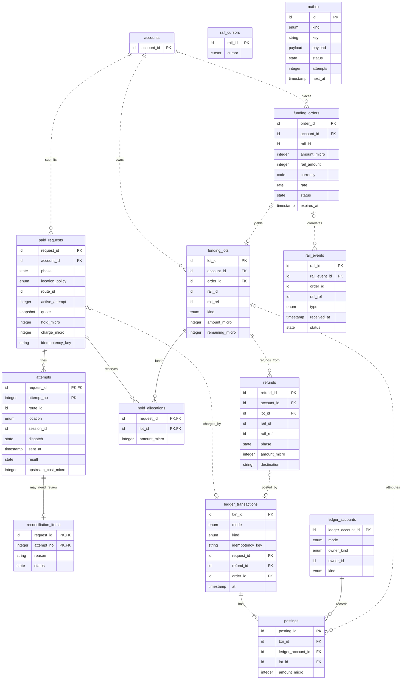

# Paid-path data model

This ERD describes the PostgreSQL schema (decision 0008) in [paid-path architecture §6.1](paid-path-architecture.md#61-units-and-tables) and the recovery tables in [§8.3](paid-path-architecture.md#83-ledger-outbox-and-inbox).

`PK` is a primary key and `FK` is an intended foreign key. Each relationship shows the proposed logical cardinality. The architecture gives a subset of the SQL constraints, so the migration should confirm FK enforcement and nullability. Amounts ending in `_micro` are integer micro-USD.

### How to read the diagram

- **Hold.** A request can reserve funds across several lots. The pair `(request_id, lot_id)` identifies one allocation. The reservation transaction verifies that the request and lot belong to the same account and checks available funds before inserting allocations.
- **Attempt.** The pair `(request_id, attempt_no)` identifies an attempt. A reconciliation item refers to that whole pair. The request's `active_attempt` refers to an attempt number within that request.
- **Charge and refund.** Partial unique indexes on `ledger_transactions(request_id)` for kind `charge` and `ledger_transactions(refund_id)` for kind `refund` allow one of each. Every table has a `mode` column, and each foreign key includes it (decision 0010).
- **Deduplication.** Requests use `UNIQUE(account_id, idempotency_key)`. Funding lots and refunds each use `UNIQUE(rail_id, rail_ref)` within their own table. Incoming rail events use `(rail_id, rail_event_id)` as their primary key.
- **Recovery.** `rail_cursors` and `outbox` appear alongside the related tables. Their polling, replay, and work-queue relationships operate through rail IDs or command and payload data. The architecture specifies no direct foreign keys from those records to requests or refunds.

### One paid request

1. A customer has 30 micro-USD in a sponsored lot and 100 micro-USD in a paid lot. A 100 micro-USD hold creates two allocations, 30 from the sponsored lot and 70 from the paid lot.
2. IE records a provider attempt before dispatch. A definite rejection can lead to a second attempt under the same request ID.
3. If the final charge is 40 micro-USD, IE consumes 30 from the sponsored lot and 10 from the paid lot under the proposed sponsored-first policy. Settlement posts the charge, ends the hold, and leaves 90 micro-USD available in the paid lot.

The charge is one `ledger_transactions` row of kind `charge` with three postings: −30 on the sponsored lot, −10 on the paid lot and +40 to platform revenue. The postings sum to zero. The partial unique index on `ledger_transactions(request_id) WHERE kind = 'charge'` keeps one charge per request (decision 0009).

Live offers and provider connections are described in [§5.1](paid-path-architecture.md#51-one-offer-type). The request row retains the selected route and quote for billing and audit.
